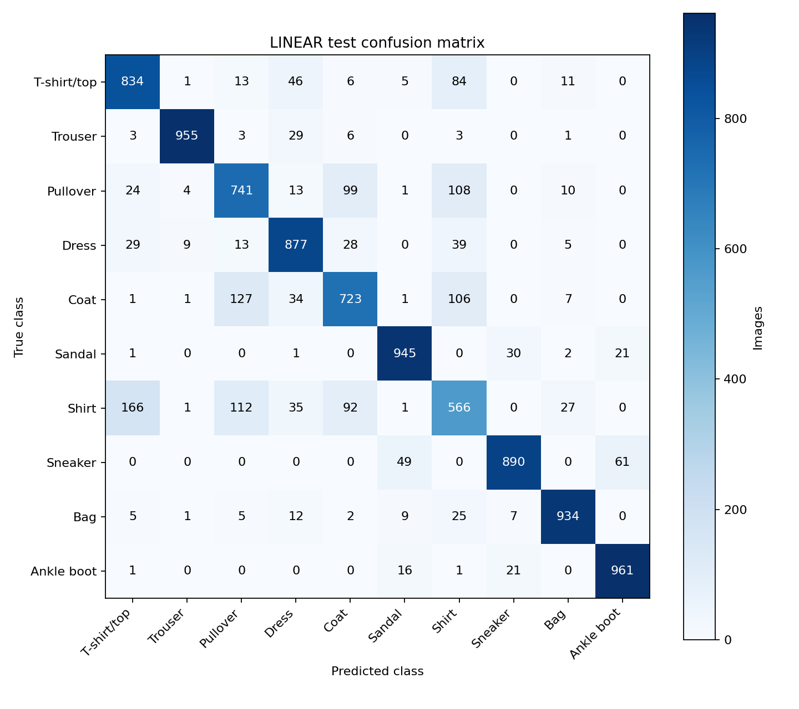
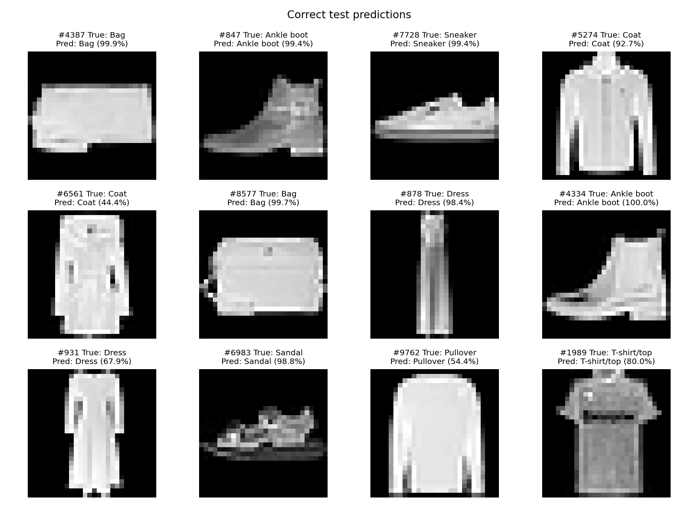
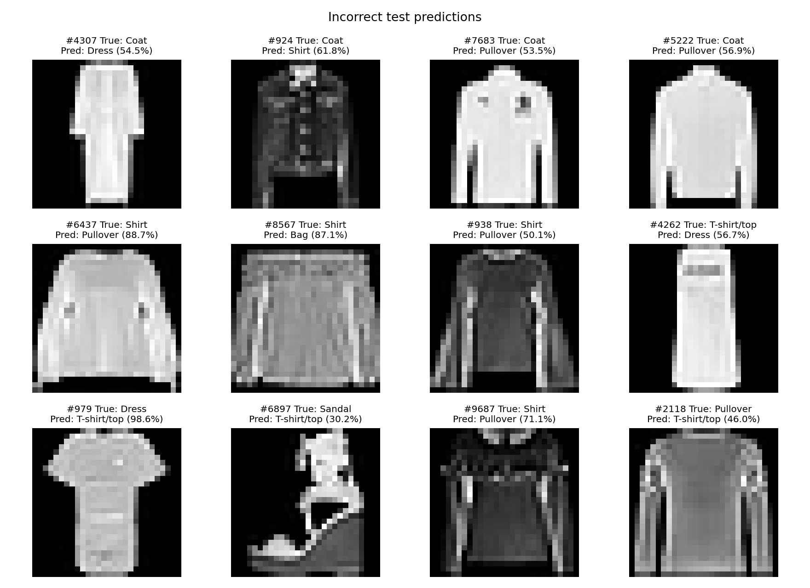
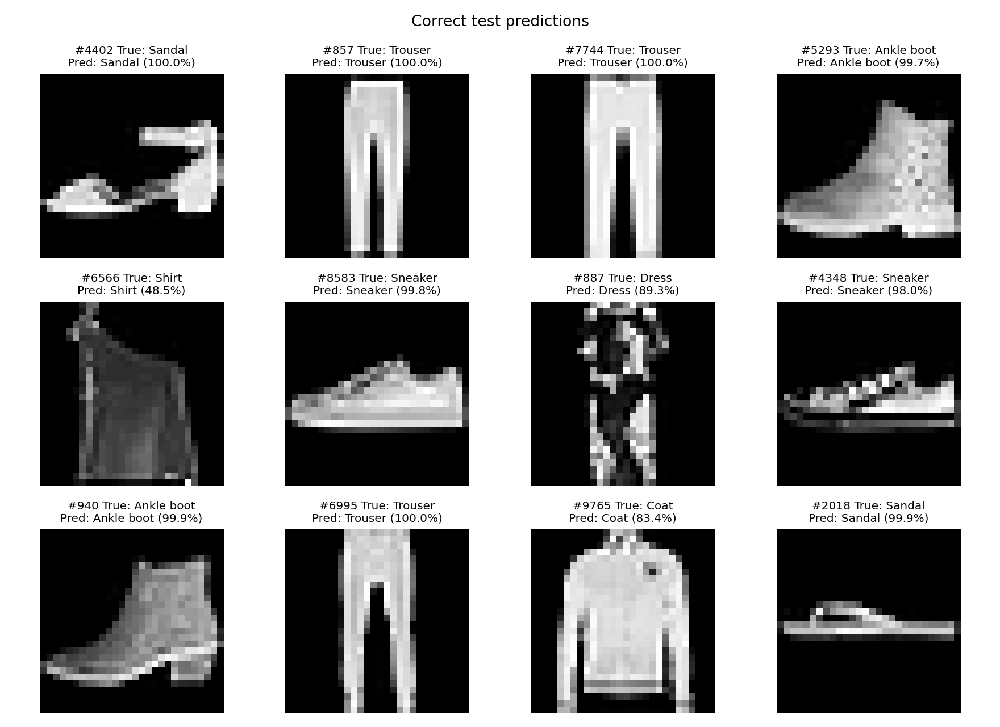
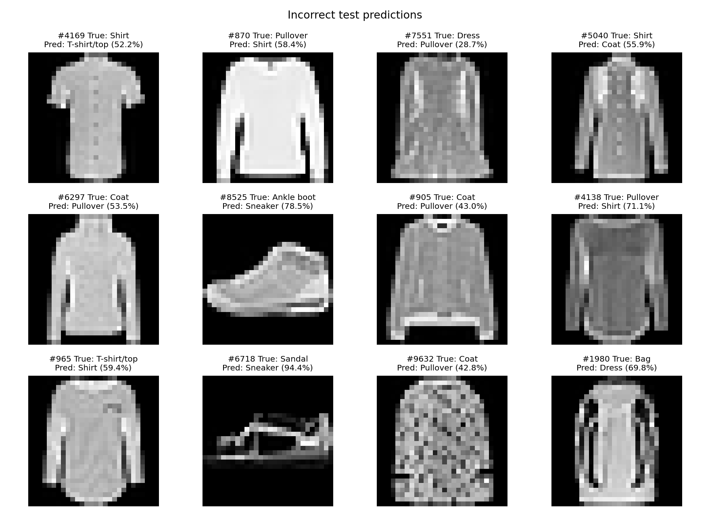

# Linear and MLP final test evaluation

On 19 October 2026, we evaluated the original M1 checkpoints on the official
10,000-image Fashion-MNIST test set. We did not retrain either model or change
its weights, split, normalization or hyperparameters. Linear uses epoch 9 and
MLP uses epoch 8, selected by the lowest validation loss in their saved histories.
Test results were not used to select either checkpoint.

## Results

| Model | Epoch | Test cross-entropy | Test accuracy | Test macro-F1 | Errors |
| --- | ---: | ---: | ---: | ---: | ---: |
| Linear | 9 | 0.445443 | 84.26% | 0.841694 | 1,574 |
| MLP | 8 | 0.325145 | 88.50% | 0.884585 | 1,150 |

Accuracy is the fraction of correct predictions. Macro-F1 averages the ten
class-specific F1 scores equally. Each test class contains 1,000 images.
The JSON summaries include precision, recall, F1 and support for every class.

Both models retain the shared seed-42 split (54,000 train / 6,000 validation),
train-only mean `0.28620901297676965` and std `0.3531597492723218`, and flattened
784-pixel inputs. Test preprocessing has no augmentation and preserves official
dataset order. Evaluation runs in float32 with `model.eval()` (dropout disabled)
and `torch.inference_mode()`.

The MLP scores 4.24 percentage points higher in test accuracy and makes 424 fewer
errors than Linear. Test accuracy is below validation accuracy by 2.22 points
for Linear and 1.37 points for MLP. These are results for one seed and one fixed
split; they do not establish variation across training runs.

## Confusion matrices and examples

Rows are true classes and columns are predicted classes. Counts sum to 10,000.
Example grids contain twelve correct or twelve incorrect predictions sampled
with seed 42, with the official test index, true class, prediction and softmax
confidence. These confidence values have not been calibrated.

### Linear

Shirt has the lowest recall (56.6%) and F1 (0.5859). Of 1,000 shirts, 166 are
predicted as T-shirt/top and 112 as Pullover. Another frequent error is Coat
predicted as Pullover (127 images). Similar upper-body silhouettes remain hard
to separate with a single linear decision function.







### MLP

Shirt still has the lowest recall (66.2%) and F1 (0.6976), but both improve over
Linear. There are 130 shirts predicted as T-shirt/top, 95 shirts as Pullover,
and 109 coats as Pullover. The hidden nonlinear layers improve recognition,
while overlap between these low-resolution garment classes remains visible.
This comparison does not isolate the effect of nonlinearity from parameter count.






## Reproduction and verification

From `A1/` in PowerShell, using the existing local environment:

```powershell
.\.venv\Scripts\python.exe -m a1.evaluate --checkpoint runs/m1/linear/best.pt
.\.venv\Scripts\python.exe -m a1.evaluate --checkpoint runs/m1/mlp/best.pt
.\.venv\Scripts\python.exe tests/verify_run.py --model linear
.\.venv\Scripts\python.exe tests/verify_run.py --model mlp
```

Each run directory contains `test_summary.json`, `test_predictions.csv`,
`confusion_matrix.csv`, `confusion_matrix.png`, `correct_examples.png`,
`incorrect_examples.png`, `learning_curves.png` and `verification.json`.
The original `best.pt`, `summary.json` and `history.csv` are retained.

Both verifiers passed. They reload the checkpoint, reproduce validation metrics,
check validation-loss selection and split/config/data/checkpoint hashes, rerun
all 10,000 test predictions and confidences, recompute test loss, accuracy,
macro-F1 and confusion counts, and validate all four PNG files. CPU/CUDA labels
also agree on a 128-image batch; maximum logit differences are about
`7.63e-6` for Linear and `4.29e-6` for MLP. The verifier infers `flatten` for
the legacy baseline files, which predate the explicit `input_mode` field.

Evaluation used NVIDIA GTX 1660 SUPER (6 GiB), Windows, Python 3.12.10,
PyTorch 2.9.1+cu128 and torchvision 0.24.1+cu128. Original M1 training was on
Apple Silicon MPS. The evaluator records hardware, software and timing scopes
in each test summary. These single-run timings do not complete a fair
five-model speed comparison; that separate task requires shared hardware.
