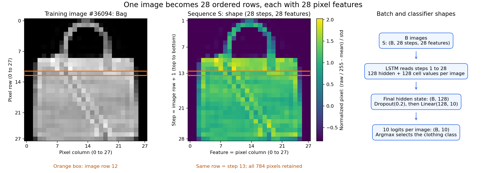
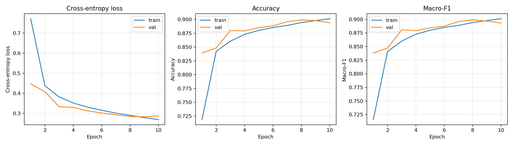
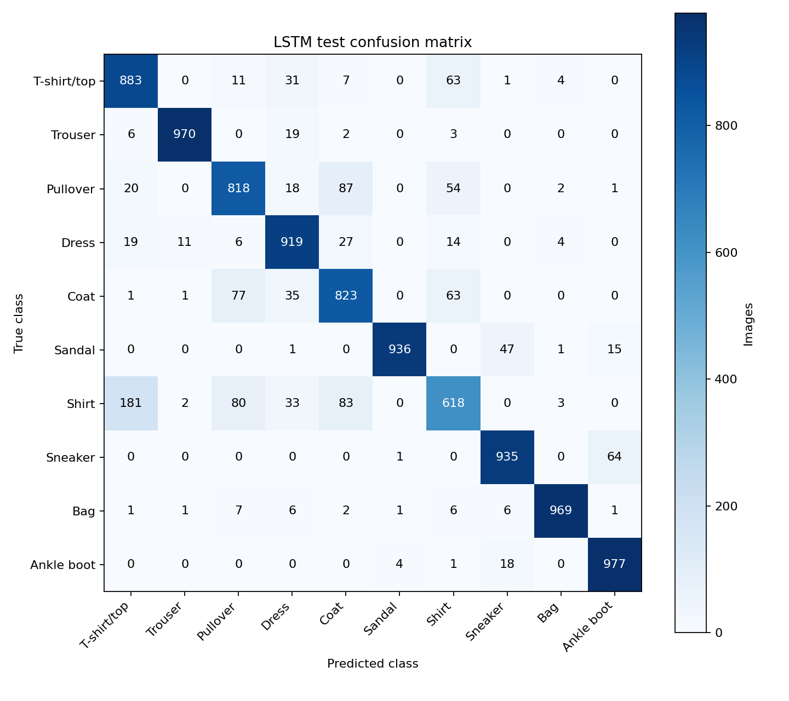
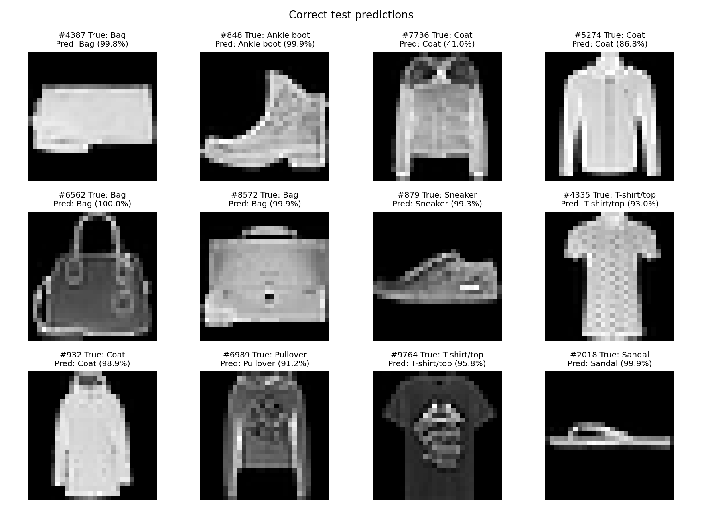
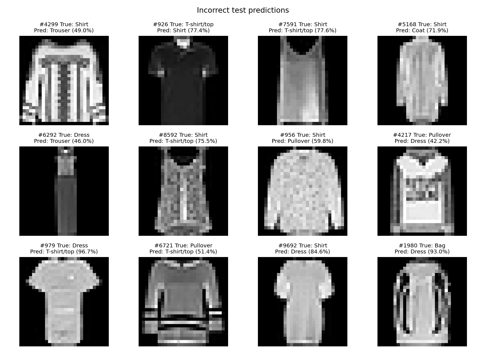

# LSTM experiment

This model classifies Fashion-MNIST by reading an image one row at a time.
It is trained from scratch using one unidirectional LSTM layer and a linear
classifier. The image is static: the sequence order is a modeling choice,
not time measured in a video.

## From image to sequence

Start with a grayscale image `P` of shape `1 x 28 x 28`. Convert its integer
pixels to float32 in `[0, 1]`, then normalize every pixel using the mean and
standard deviation computed from the 54,000 training images:

```text
Z[0, r, c] = (P[0, r, c] / 255 - 0.28620901297676965) / 0.3531597492723218
```

The `row_seq` representation removes the single channel axis:

```text
S[r, c] = Z[0, r, c]                 r, c = 0, ..., 27
S = Z.squeeze(0)                    shape: (28 steps, 28 features)
batch = stack(S_1, ..., S_B)         shape: (B, 28, 28)
```

**Each step is one complete horizontal row.** The LSTM reads the top row first,
then the next row, and finishes with the bottom row. Within each row, feature
positions follow the pixels from left to right. Thus sequence length is 28 and
`input_size` is 28. All 784 pixels remain; there is no resizing, patching,
pooling, learned embedding, or sequence of 784 individual pixel steps.

For a small illustrative image, the mapping is:

```text
image (1 channel):       sequence:
  a b c d                  step 1: [a, b, c, d]
  e f g h                  step 2: [e, f, g, h]
  i j k l                  step 3: [i, j, k, l]
  m n o p                  step 4: [m, n, o, p]
```

Both axes happen to have length 28 in Fashion-MNIST. Their meanings still
differ: axis 1 of the batch is the ordered row steps; axis 2 contains the
pixel features of a row. An accidental transpose would produce the same tensor
shape but read columns instead. Tests check exact pixel coordinates to catch it.



The diagram uses the first image in the cached training split. Image row 12
(zero-based) is highlighted as sequence step 13 (one-based). Reproduce it with
`python -m a1.plot_sequence` from `A1/`.

## Architecture and memory

| Stage | Shape for a batch of B images |
| --- | --- |
| Normalized image before representation | B x 1 x 28 x 28 |
| Row sequence, `batch_first=True` | B x 28 x 28 |
| LSTM output at every row, hidden size 128 | B x 28 x 128 |
| Returned final hidden state `h_n` | 1 x B x 128 |
| `h_n[-1]`, then Dropout(0.2) | B x 128 |
| Linear(128, 10) | B x 10 raw logits |

The LSTM carries a hidden state `h` and a cell state `c` between rows of the
same image. Its forget gate controls how much previous cell memory remains;
the input gate controls how much candidate information from the current row is
written; the output gate controls how much of the cell memory becomes the
hidden state. The same recurrent weights are reused for all 28 rows.

In simplified notation, `c_t = f_t * c_(t-1) + i_t * g_t` and
`h_t = o_t * tanh(c_t)`, where `*` means elementwise multiplication. These gates
are learned from the current row and the previous hidden state. They allow
information from earlier rows to affect the final prediction; they do not
guarantee that every earlier detail is retained.

The classifier uses the **final hidden state after all 28 rows**, not the cell
state or a mean of the row outputs. For this one-layer forward LSTM,
`h_n[-1]` also equals `output[:, -1, :]`. `batch_first` changes the input/output
layout but leaves `h_n` ordered as `(layers, batch, hidden_size)`, so indexing
`h_n[:, -1]` would incorrectly select an image instead of the layer.

Hidden and cell states start at zero separately for every image on every
forward call. They are never carried between images or batches. Since there is
only one recurrent layer, dropout is applied explicitly to the final hidden
state before the classifier; PyTorch's LSTM `dropout` argument operates between
stacked layers. Dropout is disabled during validation and test evaluation.

The parameter count is **82,186**:

```text
LSTM input weights:       4 * 128 * 28  = 14,336
LSTM recurrent weights:   4 * 128 * 128 = 65,536
Two LSTM bias vectors:    2 * 4 * 128   =  1,024
Linear weights and bias:  128 * 10 + 10 =  1,290
Total:                                  82,186
```

There are four sets of weights for the input, forget, candidate and output
computations. Raw logits feed `CrossEntropyLoss`; softmax is used only for
displayed prediction confidence. The layer shapes, gates, state semantics and
dropout behavior were checked against the [PyTorch 2.9 LSTM reference](https://docs.pytorch.org/docs/2.9/generated/torch.nn.LSTM.html).

## Protocol and reproduction

- Same source and cached stratified split as Linear, MLP and CNN:
  54,000 train / 6,000 validation / 10,000 official test images.
- Seed 42, training-only normalization, Adam with learning rate 0.001,
  batch size 128, 10 epochs, float32, no augmentation or pretrained weights.
- Select the checkpoint with the lowest validation loss before test evaluation.
- One fixed architecture and budget; test results do not guide tuning.

Use the existing Windows environment from `A1/README.md`. From `A1/`:

```powershell
$env:CUBLAS_WORKSPACE_CONFIG = ':4096:8'
.\.venv\Scripts\python.exe -m unittest discover -s tests -v
.\.venv\Scripts\python.exe -m a1.train --model lstm --config configs/lstm.json
.\.venv\Scripts\python.exe -m a1.evaluate --checkpoint runs/m2/lstm/best.pt
.\.venv\Scripts\python.exe tests/verify_lstm_run.py
.\.venv\Scripts\python.exe -m a1.plot_sequence
```

Add `--reuse-existing` to training to reload and verify a completed matching
run. The same evaluator and checkpoint loader support the LSTM without special
test-time reshaping. A CPU reload is included in the artifact verification.

Seeds, deterministic cuDNN settings, and the cuBLAS workspace environment are
used in the local run. This is not a claim of numerical identity across
hardware or library versions; see [PyTorch's reproducibility notes](https://docs.pytorch.org/docs/2.9/notes/randomness.html).

`runs/m2/lstm/` stores the validation-selected `best.pt`, `summary.json`,
`history.csv`, `test_summary.json`, all 10,000 `test_predictions.csv` rows,
confusion counts, learning curves, correct/incorrect example figures and
`verification.json`. The JSON files record configuration, input representation,
dataset/split/checkpoint hashes, normalization and software/hardware versions.

Timing follows the CNN protocol: training time includes validation and
checkpoint writes; the forward timer uses 10 warmup and 100 timed passes on one
device-resident batch of 128, excluding loading/transfers. Per-image timing is
batch latency divided by 128, not single-image latency. A separate complete test
pass includes loading, transfers, loss and predictions. M1 times were measured
on MPS and cannot support a speed ranking against the CUDA experiments.

## Results from 11 October 2026

The run used Windows 11, Python 3.12.10, PyTorch 2.9.1+cu128,
torchvision 0.24.1+cu128 and a GTX 1660 SUPER (6 GiB). The existing
`requirements-windows-lock.txt` records the tested environment.

| Measurement | Result |
| --- | ---: |
| Selected epoch (lowest validation loss) | 9 |
| Validation loss | 0.283240 |
| Validation accuracy | 89.80% |
| Validation macro-F1 | 0.896724 |
| Test loss | 0.325417 |
| Test accuracy | 88.48% (8,848 / 10,000) |
| Test macro-F1 | 0.883496 |
| Parameters | 82,186 |
| Training + validation time, 10 epochs | 122.12 s |
| Forward time, batch of 128 | 1.189 ms |
| Amortized forward time per image | 0.00929 ms |
| Complete test pass | 1.237 s |

Validation loss fell from 0.4469 at epoch 1 to 0.2832 at epoch 9, then rose
to 0.2874 at epoch 10 while training loss continued falling to 0.2687. Epoch 8
has the highest validation accuracy (89.9167%), but epoch 9 is selected because
the fixed selection rule is lowest validation **loss**. This small late increase
suggests the improvement is leveling off; one seed cannot establish a general
overfitting pattern. Test accuracy is 1.32 percentage points below the selected
checkpoint's validation accuracy.



Under the shared split, seed and 10-epoch protocol, the CNN scored 91.94% test
accuracy and 0.918886 macro-F1; this LSTM scored 88.48% and 0.883496. The CNN is
ahead by 3.46 percentage points of test accuracy. The LSTM has about 19.5% of the
CNN's parameters (82,186 vs 421,642), yet its measured training time was longer
(122.12 s vs 105.03 s) and batch forward time was slightly higher (1.189 ms vs
1.074 ms). These are individual measurements on the same GPU, not repeated
timing estimates. Sequential computation and parameter count measure different
costs. The results compare these two architectures, not all possible CNNs/LSTMs.

## Error analysis

The selected model makes 1,152 test errors. Shirt is the hardest class, with
61.8% recall and 0.6784 F1. Of 1,000 true shirts, 181 are predicted as T-shirt/top,
83 as Coat and 80 as Pullover; 63 true T-shirt/top images are predicted as Shirt.
Pullover/Coat confusion also appears in both directions: 87 pullovers become
coats and 77 coats become pullovers. Similar upper-body silhouettes remain a
problem for this checkpoint.

Trouser recall is 97.0% and Bag recall is 96.9%. Footwear confusion includes
47 sandals predicted as sneakers and 64 sneakers predicted as ankle boots.
These counts come directly from `confusion_matrix.csv`. The example grids are
reproducible samples with seed 42; softmax confidence is not calibrated.





## Checks actually run

- Eight unit tests passed: four existing CNN checks and four LSTM checks for
  pixel order/normalization, input/readout shapes and independent states,
  gradients reaching early rows/recurrent weights with optimization reducing
  loss, and checkpoint reload with evaluation dropout disabled.
- Full 10-epoch CUDA training on all 54,000 training examples; validation on
  6,000 images each epoch; final test evaluation on all 10,000 images.
- `python tests/verify_lstm_run.py` passed: split/source hashes match M1,
  normalization and model/config metadata match the checkpoint, saved validation
  metrics match a reload, and epoch 9 has the lowest history validation loss.
- A fresh checkpoint pass reproduces every test prediction and confidence;
  saved accuracy, macro-F1, test loss, confusion counts and dataset/checkpoint
  checksums are verified. All 10,000 labels match the official test labels.
- CPU/CUDA predicted labels match on a 128-image batch; the maximum absolute
  logit difference is 0.00002408, within the verification tolerance.
- The sequence diagram and four evaluation figures were visually inspected.
  Four evaluation PNGs also passed file-integrity checks.

The machine-readable artifact checks are in `runs/m2/lstm/verification.json`.

## Why this representation, and its limits

Rows make a short, fixed-length sequence while keeping horizontal pixel
positions explicit. The recurrent state can combine information from the top
and bottom of a garment. However, this imposes a directional order on a 2D
image. The row projection treats the 28 pixel positions as distinct features;
it does not share a small horizontal filter across positions as a CNN does.
The LSTM also reads 28 dependent steps and compresses earlier rows into a fixed
state. Fewer parameters therefore do not imply faster inference or better
accuracy.

Column order, bidirectionality, multiple layers, alternative readouts and
different hidden sizes are possible variants, but they were not searched here.
This experiment has one seed, one split and one 10-epoch budget. Comparisons
change model family and parameter count together, so they cannot isolate the
effect of sequence order. The full five-model comparison is still incomplete.
