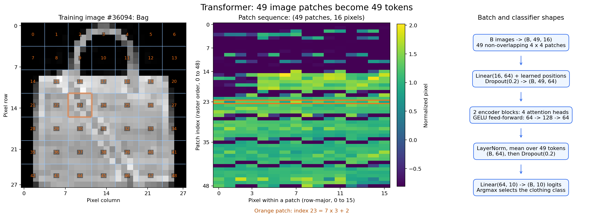
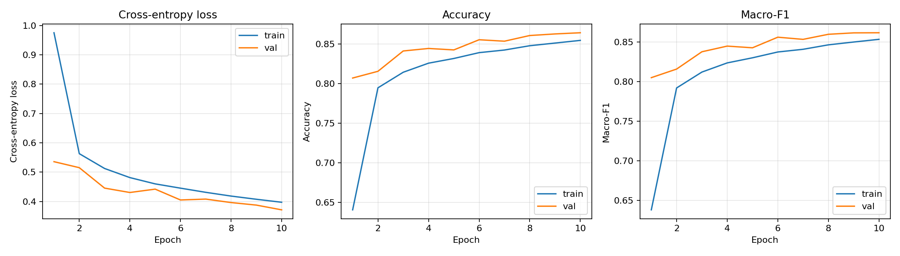
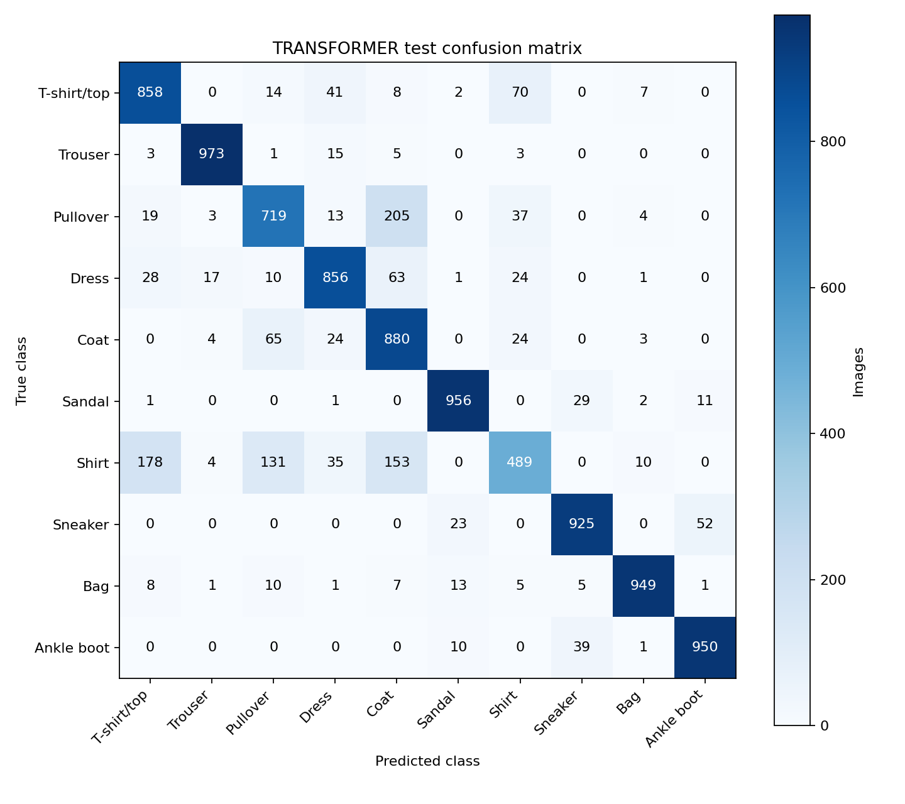
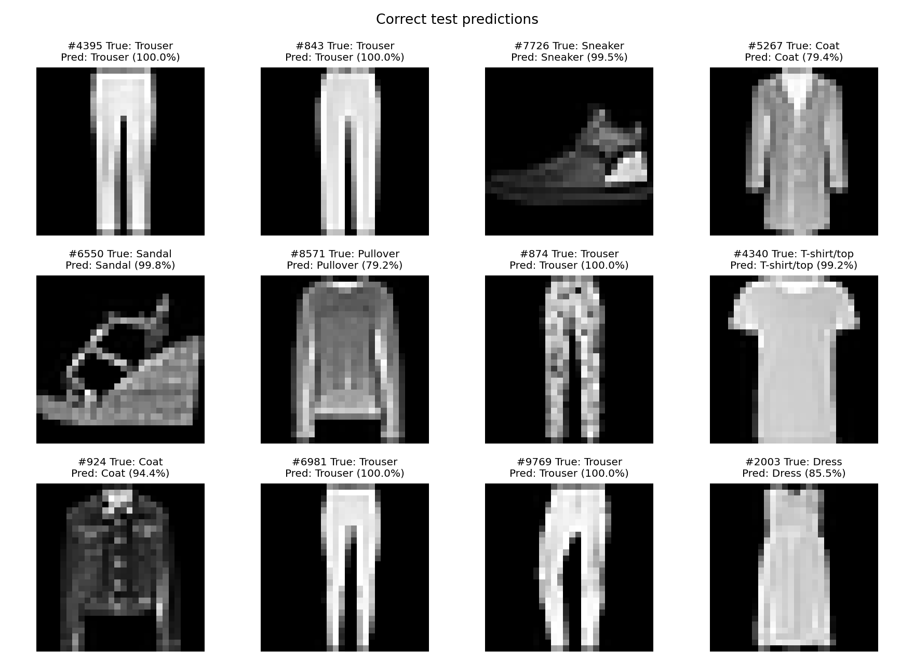
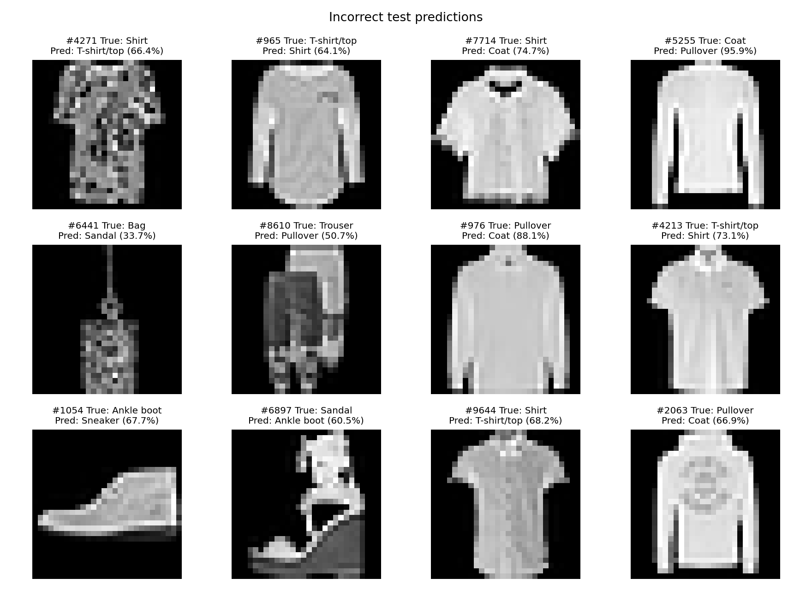

Finish error analysis and conclusion: Linear, MLP and Transformer analysis is missing; several M2 TODOs remain on the page.# Transformer experiment: Fashion-MNIST

This is a small image Transformer trained from scratch for Assignment 1 M2.
It uses the same data split and training budget as the CNN and LSTM. It is a
patch-based encoder classifier inspired by Vision Transformer, with mean
pooling instead of a class token. It uses no pretrained weights or decoder.

## How an image becomes tokens

The raw image is one 28 x 28 grayscale array. `ToTensor` changes it to
`float32` in [0, 1], then the shared training-only mean and standard deviation
normalize it. The normalized tensor `Z` has shape `(1, 28, 28)`.

We divide it into a 7 x 7 grid of non-overlapping 4 x 4 patches. Patches run
left to right across the first patch row, then across the next row, down to
the bottom-right corner. Pixels within each patch also run left to right,
top to bottom. With zero-based indices, the exact mapping is:

```text
P[7*r + c, 4*i + j] = Z[0, 4*r + i, 4*c + j]
r, c in 0..6; i, j in 0..3
```

Thus patch 0 contains rows 0..3 and columns 0..3; patch 1 contains rows 0..3
and columns 4..7; patch 7 starts at row 4, column 0. All 784 pixels are
retained exactly once: 49 patches x 16 pixels. A batch has shape
`(B, 49, 16)`. Patching itself is a reversible rearrangement, with no pooling,
padding or cropping. The `patch_seq` conversion lives in `a1/data.py`.



## Model and tensor shapes

| Stage | Operation | Output shape |
| --- | --- | --- |
| Patches | 49 flattened 4 x 4 patches per image | B x 49 x 16 |
| Embedding | Shared Linear(16, 64) | B x 49 x 64 |
| Position | Add learned position vectors (1 x 49 x 64), then Dropout(0.2) | B x 49 x 64 |
| Encoder input | Transpose to sequence-first layout | 49 x B x 64 |
| Encoder | Two independently initialized pre-norm encoder blocks | 49 x B x 64 |
| Encoder output | Transpose back to batch-first layout | B x 49 x 64 |
| Final normalization | LayerNorm(64) on each token | B x 49 x 64 |
| Readout | Mean across the 49 tokens, then Dropout(0.2) | B x 64 |
| Classifier | Linear(64, 10) | B x 10 |

Each encoder block has four attention heads. Each head works in 16 dimensions
because 64 / 4 = 16. The input tokens produce queries, keys and values;
`softmax(Q K^T / sqrt(16)) V` mixes patch information within each image.
Concatenating the four heads and projecting them gives the attention output.
There is no causal mask: every patch can attend to all 49 patches. There is
no padding mask because every image supplies all patches. Batch-first inputs
keep images separate at the model boundary; inside the encoder, sequence-first
inputs `(49, B, 64)` preserve the same per-image attention. Attention never
mixes different images.

A block applies LayerNorm before attention, adds a residual connection, then
applies LayerNorm before a `64 -> 128 -> 64` feed-forward network with GELU,
and adds its second residual connection. Attention and feed-forward dropout
use probability 0.2. After both blocks, the final normalized tokens are
averaged and classified. Evaluation disables all dropout. The classifier
returns raw logits for `CrossEntropyLoss`; softmax is used only to display
prediction confidence.

The learned position vectors tell the model where each patch belongs. Without
them, self-attention followed by mean pooling would be invariant to patch
permutations. There is no separate class token. The two blocks are constructed
separately, avoiding identical initial attention weights from copying one
encoder layer.

The blocks use PyTorch's sequence-first layout to stay on its standard attention
path. During verification, fused batch-first CUDA inference on this stack
differed from CPU by up to 0.00244 in the logits of a 128-image batch, while the
standard CUDA path differed by less than 0.000003 from a float64 CPU reference.
Labels agreed on that batch. We therefore used sequence-first blocks and
reran the same ten-epoch experiment and test evaluation. This numerical fix
changes no parameters, attention connectivity, dropout or training settings;
no test score was used to select a model or hyperparameter. No global PyTorch
backend flags are changed. A CPU/CUDA unit test guards this behavior.

| Component | Trainable parameters |
| --- | ---: |
| Patch projection (16 x 64 + 64) | 1,088 |
| Position vectors (49 x 64) | 3,136 |
| Encoder block 1 | 33,472 |
| Encoder block 2 | 33,472 |
| Final LayerNorm | 128 |
| Classifier (64 x 10 + 10) | 650 |
| **Total** | **71,946** |

Each block has 16,640 attention parameters, 16,576 feed-forward parameters,
and 256 LayerNorm parameters. The architecture is fixed in
`TransformerClassifier` in `a1/models.py`; the run settings are in
`configs/transformer.json`.

## Experiment protocol

- Fashion-MNIST: 54,000 training, 6,000 validation, 10,000 official test images.
- Seed 42 and the existing stratified split in `split_cache.json`.
- Shared train-only normalization: mean 0.286209, standard deviation 0.353160.
- Adam at learning rate 0.001; batch size 128; 10 epochs; augmentation off.
- Full float32 training, without a scheduler, pretraining or test-based tuning.
- The checkpoint with lowest validation cross-entropy is selected before the
  official test evaluation. The run directory retains that checkpoint and all
  10 epochs of metrics, even if a later epoch has higher validation accuracy.
- Architecture and settings were fixed before inspecting test results.

The environment is the retained Windows `.venv`: Python 3.12.10,
PyTorch 2.9.1+cu128, torchvision 0.24.1+cu128, and NVIDIA GTX 1660 SUPER
(6 GiB). Exact versions and hardware are saved in the run summaries.

## Reproduce and verify

Run from `A1/` in PowerShell:

```powershell
.\.venv\Scripts\python.exe -m pip check
.\.venv\Scripts\python.exe -m unittest discover -s tests -v
.\.venv\Scripts\python.exe -m a1.train --model transformer --config configs/transformer.json
.\.venv\Scripts\python.exe -m a1.evaluate --checkpoint runs/m2/transformer/best.pt
.\.venv\Scripts\python.exe tests/verify_transformer_run.py
.\.venv\Scripts\python.exe -m a1.plot_patches
```

Add `--reuse-existing` to the training command to validate and reuse the saved
run. Running without it trains again and replaces that model's run artifacts.
For a new environment, follow the Windows setup in `../README.md`, using
`requirements-windows-lock.txt` for the tested dependency versions.

The run verifier checks config/data/split hashes, train-only normalization,
exact patch order, parameter count, validation-loss selection, checkpoint
reload, all 10,000 predictions and confidences, recomputed loss/accuracy/F1 and
confusion matrix, test data and checkpoint hashes, CPU/CUDA agreement on one
128-image batch, and the four result PNGs. Unit tests additionally check
position sensitivity, permutation invariance without positions, gradient flow
to every patch and both attention blocks, dropout, invalid inputs and reloads.

## Measured results: 19 October 2026

Epoch **10** has the lowest validation loss. The selection rule consistently
uses loss, rather than selecting a checkpoint by test performance.

| Partition | Cross-entropy loss | Accuracy | Macro-F1 | Images |
| --- | ---: | ---: | ---: | ---: |
| Validation | 0.371269 | 86.43% | 0.861705 | 6,000 |
| Official test | 0.408519 | 85.55% | 0.852387 | 10,000 |

Training plus validation took **139.45 s** on the GTX 1660
SUPER. With a device-resident batch of 128 images, mean forward latency was
**2.061 ms per batch**, or
0.01610 ms per image amortized, over 100 timed
passes after 10 warmup passes. This excludes data loading and host transfers.
The full test pass, including loading, transfers, loss and predictions, took
1.595 s; plotting is excluded. These are single
measurements, without repeated-timing uncertainty estimates.



At epoch 10, training loss is 0.3972 and validation loss is 0.3713. Training
loss is measured with dropout active and changing weights, whereas validation
uses fixed weights and disables dropout; these losses are not a direct test
of overfitting. Both generally decline over the run, with some validation
fluctuations; ten epochs do not establish that
this architecture has converged. The test accuracy is
6.39 percentage points below CNN (91.94%) and
2.93 points below LSTM (88.48%) under the shared split
and budget. The Transformer has fewer parameters than either, but this does
not establish why its accuracy is lower. The earlier Linear/MLP scores are
validation-only and must not be directly ranked against these test scores.

### Error analysis

The selected model makes **1,445 test errors**. **Shirt** has the lowest
recall (48.9%) and F1 (0.5920). Among the
1,000 true Shirt images, the largest confusions are 178 as T-shirt/top, 153 as Coat, 131 as Pullover.
These measured counts are consistent with the EDA observation that upper-body
garments share similar silhouettes at this resolution. They do not identify
the specific image features used by the model. Test image 5763 is a Dress predicted as Trouser at 99.95% confidence.
High confidence can therefore accompany an incorrect prediction.





### Checks actually run

- `pip check`: no broken requirements.
- All **13 unit tests passed**, including the CUDA numerical regression test.
- The final ten-epoch CUDA training and full official-test evaluation completed.
- The saved-run verifier passed: all 10,000 saved predictions and confidences
  match checkpoint inference; metrics/confusion counts are recomputed; data,
  split, config and checkpoint hashes agree; patch ordering is exact.
- CPU/CUDA labels agree on a 128-image batch. Maximum absolute logit difference
  is 0.000001907, within the original 0.0001 tolerance.
- Four result PNGs pass integrity checks; these and the representation diagram
  were visually checked. The new notebook appendix was executed successfully.

Artifacts: [training summary](../runs/m2/transformer/summary.json),
[test summary](../runs/m2/transformer/test_summary.json),
[verification](../runs/m2/transformer/verification.json),
[checkpoint](../runs/m2/transformer/best.pt), and
[predictions](../runs/m2/transformer/test_predictions.csv).

## Limits

This is one small architecture, seed and 10-epoch run. It does not establish a
general ranking of Transformers, CNNs or LSTMs. Model capacity and inductive
bias change together. No alternative patch sizes, pooling methods, depths or
learning rates were compared. Patch projection retains every raw pixel as an
input, but mean pooling compresses the learned output. Prediction confidence
is not calibrated. Attention weights were not analyzed and should not be
treated as explanations for the individual errors.

## References

- [Dosovitskiy et al., An Image is Worth 16x16 Words](https://arxiv.org/abs/2010.11929):
  patch-token image classification with a Transformer; our model is a smaller
  adaptation with mean pooling.
- [PyTorch 2.9 TransformerEncoderLayer](https://docs.pytorch.org/docs/2.9/generated/torch.nn.TransformerEncoderLayer.html):
  encoder attention/feed-forward operations and sequence/pre-norm settings.
- [PyTorch 2.9 TransformerEncoder](https://docs.pytorch.org/docs/2.9/generated/torch.nn.TransformerEncoder.html):
  initialization warning for cloned encoder layers; our blocks are constructed
  separately.

## AI assistance and review

On 19 October 2026, OpenAI Codex helped implement and test the Transformer,
run the experiment, explain the patch representation and update the assignment
materials. Group members must review the code, plots and claims before
submission. The root `AI_USAGE.md` was left untouched as instructed.
