# Abstract

This report compares five neural network configurations for Fashion-MNIST image classification: a Linear classifier, a multilayer perceptron (MLP), a convolutional neural network (CNN), a row-sequence LSTM and a patch-based Transformer. The models receive the same pixels, arranged as vectors, image grids, rows or patches. The study examines how these choices relate to predictive quality, training behavior and computational cost.

The official training data is divided into 54,000 training and 6,000 validation images using a stratified split with seed 42. The official test set contains 10,000 images. Normalization uses statistics from the training partition only. All five models use Adam with a learning rate of 0.001, batches of 128 and ten epochs, without data augmentation. The checkpoint with the lowest validation loss is evaluated on the test set.

The CNN achieves the highest test accuracy, 91.94%, and macro-F1, 0.9189. MLP and LSTM obtain 88.50% and 88.48% accuracy, followed by Transformer at 85.55% and Linear at 84.26%. The CNN makes 806 errors, compared with 1,150 for the MLP. It also has the most parameters, at 421,642. Under the recorded GTX 1660 SUPER inference measurement, the MLP takes 0.247 milliseconds per 128-image forward batch and the CNN takes 1.074 milliseconds.

Class-level analysis shows that upper-body garments remain the main difficulty. The CNN correctly identifies 71.8% of Shirt images, compared with 98.8% of Trouser images. Its mistakes often occur between Shirt, T-shirt/top, Pullover and Coat. These errors are consistent with the similar silhouettes observed in the training data, although that observation alone does not establish why an individual prediction failed.

The results favor the implemented CNN for accuracy and show the MLP as a useful lower-cost alternative in the recorded batch timing. Conclusions are limited to one seed and the tested configurations. Model capacity differs, training hardware is not shared across all five runs, and the study does not estimate variation across repeated training runs.

**Keywords:** Fashion-MNIST; image classification; CNN; LSTM; Transformer; model comparison.

# 1 Introduction

## 1.1 Background and motivation

Image classification assigns a category to an image. For a product catalogue, this could help organize new items into clothing and accessory groups. Reliable classification depends on more than the model: the data split, preprocessing and evaluation procedure also affect how a result should be interpreted.

Fashion-MNIST provides a manageable setting for studying this process \[1\]. Its small grayscale images make it practical to train several models, while visually similar categories create a useful recognition challenge. A shirt and a pullover, for example, may have similar outlines even though they belong to different labels.

Different architectures use image information in different ways. A Linear classifier combines pixel values directly. An MLP learns nonlinear combinations of pixels. A CNN learns local spatial patterns, an LSTM reads an ordered sequence of rows, and a Transformer combines information across image patches. Comparing these approaches helps explain what each design contributes in a small, controlled experiment.

## 1.2 Problem statement

The task is supervised, single-label classification into ten categories. A raw image is $`X\in\{0,\ldots,255\}^{28\times28}`$ and its label is $`y\in\{0,\ldots,9\}`$. After preprocessing $`T`$, a model with parameters $`\theta`$ produces ten scores:
``` math
f_\theta(T(X))=z\in\mathbb{R}^{10},
\qquad \hat y=\arg\max_{k\in\{0,\ldots,9\}}z_k.
```
The prediction describes the complete image. The study does not locate objects within an image or assign several labels to one image.

The main question is how the five implemented configurations compare when they use the same training examples, normalization and epoch budget. We examine both overall performance and the types of mistakes hidden by an aggregate score.

## 1.3 Objectives and scope

The project has four objectives:

1.  Inspect the dataset and establish a reproducible preprocessing and split protocol.

2.  Implement and compare Linear, MLP, CNN, LSTM and Transformer classifiers.

3.  Evaluate accuracy, macro-F1, learning behavior and class-specific errors.

4.  Relate predictive quality to parameter count and documented runtime measurements.

The experiments use Fashion-MNIST only, with no pretrained weights, external training data or augmentation. Each model is trained once using seed 42 and ten epochs. The comparison concerns these particular configurations; architecture, parameter count and computation are not independently controlled.

## 1.4 Report approach

Section 2 describes the data, exploratory findings and preprocessing. Section 3 explains the models and the common training procedure. Section 4 compares the saved results and runtime measurements. Section 5 examines class-level and image-level errors. Sections 6 and 7 discuss the limitations and conclusions. The appendices provide the numerical class results, additional confusion matrices and reproduction instructions.

The analysis uses the existing completed runs. Their saved predictions are used to recompute accuracy, class scores and confusion counts. Validation selects the checkpoint; the reported test results are kept separate from that selection.

# 2 Dataset and Exploratory Analysis

## 2.1 Dataset and partitioning

Fashion-MNIST contains 60,000 official training images and 10,000 official test images \[1, 2\]. Each image has $`28\times28`$ grayscale pixels, with integer intensities from 0 to 255. There are ten labels, listed in Table 1.

<div id="tab:labels">

| Label | Category    | Label | Category   |
|:-----:|:------------|:-----:|:-----------|
|   0   | T-shirt/top |   5   | Sandal     |
|   1   | Trouser     |   6   | Shirt      |
|   2   | Pullover    |   7   | Sneaker    |
|   3   | Dress       |   8   | Bag        |
|   4   | Coat        |   9   | Ankle boot |

Table 1. Fashion-MNIST labels used throughout the report.

</div>

The official training source is divided into training and validation partitions with a stratified 90/10 split and seed 42. The official test partition is kept separate. Every class has the same number of examples within each partition.

<div id="tab:splits">

| Partition  | Images | Per class | Purpose                                   |
|:-----------|-------:|----------:|:------------------------------------------|
| Training   | 54,000 |     5,400 | Fit normalization and update weights.     |
| Validation |  6,000 |       600 | Select the checkpoint by validation loss. |
| Test       | 10,000 |     1,000 | Evaluate the selected checkpoint.         |

Table 2. Fixed partitions and their roles.

</div>

The cached training and validation indices are disjoint and together cover the 60,000 training-source images. The saved dataset audit found no exact duplicate images within the partitions or across their boundaries. The audit compares raw image hashes, so it does not rule out near duplicates or related products. No images are removed or reassigned.

## 2.2 Exploratory analysis

### Class balance and visual variation

Each class represents 10% of every partition. The training procedure therefore uses the same loss weight for every class. Equal class counts still allow large differences in difficulty, which motivates the per-class analysis in Section 5.

Figure 1 shows three training examples per class, selected with seed 42. Trousers, bags and footwear have relatively distinctive overall shapes. Upper-body garments share a torso and sleeves, while their outlines and brightness vary within each class. These examples illustrate the task; three images cannot establish how often a particular pattern occurs.

Descriptive statistics and visual summaries use the 54,000 training images. Validation and test images contribute only to structural checks and the duplicate audit at this stage. This keeps held-out data separate from the statistics used to prepare model inputs.

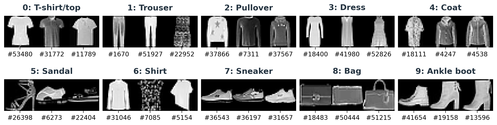

*Figure 1. Three training examples per class. Numbers identify the original training-source indices. All images use the same 0–255 display range.*

### Pixel intensity and background

The training subset contains 42,336,000 pixels. Their raw mean is 72.9833 and their population standard deviation is 90.0557. Approximately 50.21% of these pixels are exactly zero, but none of the training images is entirely blank. A large background region therefore does not indicate an empty sample.

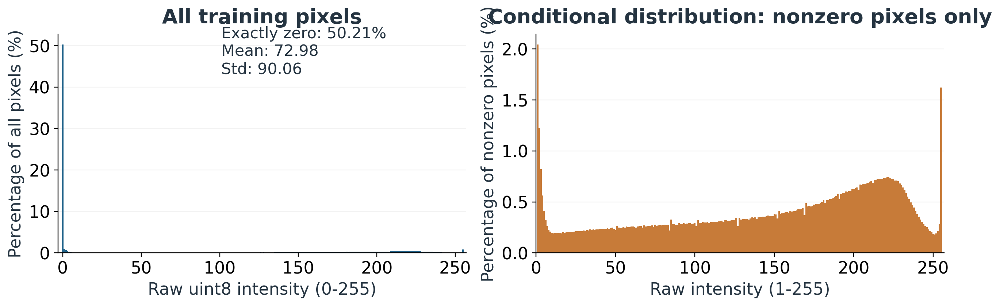

*Figure 2. Training-pixel intensity distributions. The left panel includes all pixels; the right panel conditions on positive intensities. The panels use different denominators.*

The large zero-intensity mass is consistent with the dark background visible in the samples. Positive pixels include both object interiors and faint edges. Counting nonzero pixels is useful for describing coverage, but is not a semantic segmentation of the clothing item.

### Brightness, coverage and spatial structure

For each image, mean brightness is the average of its 784 raw intensities. Nonzero coverage is the fraction of pixels with intensity greater than zero. Table 3 summarizes these quantities by class.

<div id="tab:brightness">

| Class       | Mean brightness | Brightness SD | Nonzero coverage (%) |
|:------------|----------------:|--------------:|---------------------:|
| T-shirt/top |           83.02 |         28.84 |                59.38 |
| Trouser     |           56.91 |         14.55 |                34.91 |
| Pullover    |           96.17 |         32.70 |                64.84 |
| Dress       |           65.91 |         21.33 |                42.67 |
| Coat        |           98.15 |         26.46 |                60.19 |
| Sandal      |           34.87 |         15.74 |                32.10 |
| Shirt       |           84.84 |         32.90 |                62.87 |
| Sneaker     |           42.81 |         12.85 |                33.81 |
| Bag         |           90.28 |         28.81 |                58.61 |
| Ankle boot  |           76.87 |         18.32 |                48.48 |

Table 3. Training statistics by class. Each row represents 5,400 images. Brightness SD is the standard deviation of image means.

</div>

Sandal has the lowest mean brightness, 34.87, while Coat has the highest, 98.15. Pullover has the largest mean nonzero coverage, 64.84%. These are class averages, not decision rules: individual images vary and the class distributions overlap.

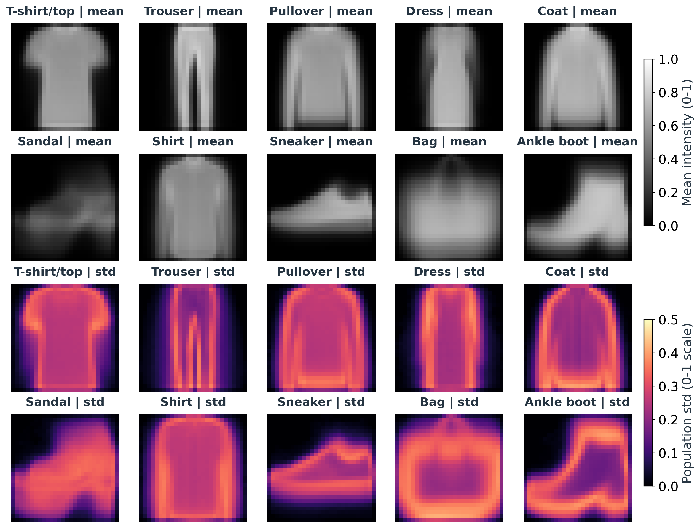

*Figure 3. Training class-average images and pixelwise standard deviations. The average highlights recurring silhouettes; the standard deviation shows where images within a class differ.*

The class averages preserve broad silhouettes while removing much individual detail. The recorded cosine similarity between the uncentered Coat and Shirt averages is 0.9873, the highest pair in the audit. This suggests a useful question for error analysis: do models confuse upper-body garments? It does not measure the separability of individual images or prove a particular confusion rate.

## 2.3 Preprocessing

### Scaling and training-only standardization

Raw intensities are first converted to floating-point values and divided by 255. The training mean $`\mu`$ and population standard deviation $`\sigma`$ are then computed over all training pixels. For a raw pixel $`X_{r,c}`$, the normalized value is
``` math
Z_{r,c}=\frac{X_{r,c}/255-\mu}{\sigma},
\qquad \mu=0.286209,\quad \sigma=0.353160.
```
The values shown are rounded; the code uses the full-precision cached constants. Validation and test images reuse these constants without fitting their own statistics. This prevents held-out images from influencing normalization.

The transformation preserves resolution and pixel ordering. Raw values 0 and 255 map to approximately $`-0.810`$ and $`2.021`$, without clipping.

### Input arrangements

The same standardized image is rearranged to match each model: Linear and MLP receive 784 pixels in row-major order; CNN receives a single channel image grid; LSTM receives 28 top-to-bottom rows; and Transformer receives 49 non-overlapping $`4\times4`$ patches in raster order.

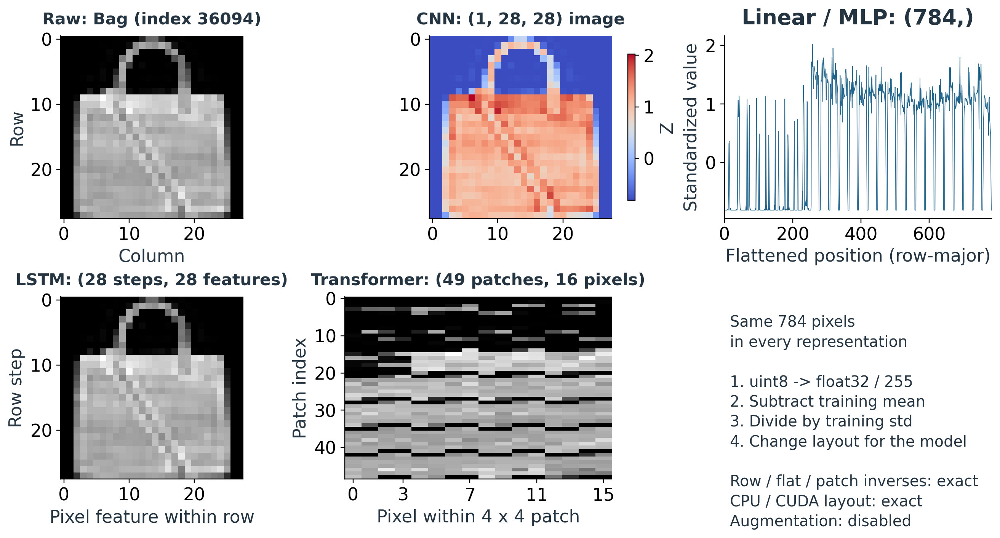

*Figure 4. Equivalent input arrangements for the same image. Each arrangement retains all 784 standardized pixel values. Learned embeddings belong to the model, after preprocessing.*

For Transformer patch coordinates $`a,b\in\{0,\ldots,6\}`$ and local coordinates $`u,v\in\{0,\ldots,3\}`$, the mapping is
``` math
P_{7a+b,\,4u+v}=Z_{4a+u,\,4b+v}.
```
Thus $`49\times16=784`$ values are retained without padding or interpolation. For the LSTM, the sequence describes ordered positions in one static image; it is not a time series of different images.

### Augmentation and verification

No rotations, flips, resizing, denoising or other augmentation are applied. The recorded preprocessing checks confirm that the standardized training data has mean approximately zero and population standard deviation approximately one, with deviations below $`10^{-6}`$. They also confirm pixel ordering, exact patch reconstruction and CPU/CUDA agreement.

The following methodology compares ways of using this shared image information, with particular interest in local structure and similar garment silhouettes.

# 3 Methodology

The experiment compares five ways of classifying a clothing image: Linear, MLP, CNN, LSTM and Transformer. Each model receives the same image information, but processes it differently. Linear and MLP use a pixel vector, CNN uses the image grid, LSTM reads image rows, and Transformer works with small image patches. This section describes the implemented models and the procedure used to train and evaluate them.

## 3.1 Shared data and workflow

Fashion-MNIST contains ten classes of $`28\times28`$ grayscale images \[1\]. As described in Section 2, the official training set is divided into 54,000 training images and 6,000 validation images using a stratified split with seed 42. The official test set contains 10,000 images. Training fits the model weights, validation chooses which saved weights to keep, and testing measures the selected model.

All models use the preprocessing from Section 2. Pixel values are divided by 255 and standardized with the training mean and standard deviation, approximately 0.286209 and 0.353160. The same constants are reused for validation and testing. No images are resized, augmented or removed.

<div class="center">

<table>
<tbody>
<tr>
<td style="text-align: center;">Standardized image</td>
<td style="text-align: center;">Model-specific input</td>
<td style="text-align: center;">Ten class scores</td>
</tr>
<tr>
<td colspan="3" style="text-align: center;">Training updates weights; validation selects weights; testing evaluates them.</td>
</tr>
</tbody>
</table>

</div>

Table 4 gives the input to each model. Here, $`B`$ is the number of images in a batch. Each representation contains all 784 pixel values per image. The labels are integer class indices from 0 to 9. Every model returns a tensor of shape $`(B,10)`$ containing raw class scores, called logits.

<div id="tab:fresh_inputs">

| Model       | Input shape     | Arrangement                     | Parameters |
|:------------|:----------------|:--------------------------------|-----------:|
| Linear      | $`(B,784)`$     | One vector per image            |      7,850 |
| MLP         | $`(B,784)`$     | One vector per image            |    235,146 |
| CNN         | $`(B,1,28,28)`$ | One grayscale image grid        |    421,642 |
| LSTM        | $`(B,28,28)`$   | 28 rows, each with 28 pixels    |     82,186 |
| Transformer | $`(B,49,16)`$   | 49 patches, each with 16 pixels |     71,946 |

Table 4. Inputs and trainable parameter counts of the implemented models.

</div>

## 3.2 Pixel-based baselines

### Linear classifier

The Linear model assigns a weight to each pixel for each class. For a flattened image $`x\in\mathbb{R}^{784}`$, its output is
``` math
z=Wx+b,\qquad W\in\mathbb{R}^{10\times784},\quad b\in\mathbb{R}^{10}.
```
The largest score determines the prediction. This model provides a small baseline with no hidden layer. It can learn which pixel positions support a class, but cannot learn nonlinear combinations of those pixels.

### Multilayer perceptron

The MLP adds two hidden layers with 256 and 128 units. Each hidden layer is followed by ReLU and dropout with probability 0.2. ReLU sets negative values to zero, while dropout randomly suppresses some activations during training.
``` math
784 \;\longrightarrow\; 256 \;\longrightarrow\; 128
\;\longrightarrow\; 10.
```
The hidden layers allow the MLP to learn nonlinear relationships among pixels. The image is still treated as a vector: nearby pixels do not receive a special shared operation. Dropout is disabled during validation and testing.

## 3.3 Models for spatial and sequential structure

### Convolutional neural network

The CNN keeps the two-dimensional image layout. Convolution applies the same small filter at different image positions, allowing the network to learn local patterns such as edges and contours \[3\]. Our model has two convolutional blocks, followed by a dense classifier.

Both convolutions use $`3\times3`$ kernels, stride 1 and padding 1, so they preserve height and width. ReLU follows each convolution. A $`2\times2`$ max-pooling layer then keeps the largest value in each window and halves both spatial dimensions. The first block produces 32 feature maps and the second produces 64.

<div id="tab:fresh_cnn">

| Operation                                   | Output shape     |
|:--------------------------------------------|:-----------------|
| Input image                                 | $`(B,1,28,28)`$  |
| $`3\times3`$ convolution, 32 channels; ReLU | $`(B,32,28,28)`$ |
| $`2\times2`$ max pooling                    | $`(B,32,14,14)`$ |
| $`3\times3`$ convolution, 64 channels; ReLU | $`(B,64,14,14)`$ |
| $`2\times2`$ max pooling                    | $`(B,64,7,7)`$   |
| Flatten                                     | $`(B,3136)`$     |
| Dense layer, 128 units; ReLU; dropout 0.2   | $`(B,128)`$      |
| Dense layer, 10 outputs                     | $`(B,10)`$       |

Table 5. CNN operations and output sizes.

</div>

The final classifier combines the learned spatial features into ten scores. Although convolution shares weights across positions, the dense layer from 3,136 features to 128 units accounts for most of this model’s parameters. The CNN therefore has the largest parameter count in this comparison.

### Row-sequence LSTM

An LSTM maintains a hidden state and a memory state while reading a sequence \[4\]. Here, the sequence comes from a static image. The first step receives the top row, the second receives the next row, and the last receives the bottom row. Each step contains 28 pixel values.

For a standardized image $`X`$, row $`t`$ is $`r_t=X_{0,t,:}`$. The batch shape $`(B,28,28)`$ means *batch, row steps, pixel features*. The two dimensions of size 28 have different roles; the sequence is not a sequence of different images.

<div class="center">

<table>
<tbody>
<tr>
<td style="text-align: center;">Row 1</td>
<td style="text-align: center;">Row 2</td>
<td style="text-align: center;"><span class="math inline">⋯</span></td>
<td style="text-align: center;">Row 28</td>
</tr>
<tr>
<td colspan="4" style="text-align: center;">One shared LSTM reads the rows in order.</td>
</tr>
<tr>
<td colspan="4" style="text-align: center;"><span class="math inline"><em>h</em><sub>28</sub> ∈ ℝ<sup>128</sup> → dropout 0.2 → dense layer → 10 scores</span></td>
</tr>
</tbody>
</table>

</div>

The implementation uses one forward LSTM layer with 128 hidden units. Its hidden and memory states start at zero for each image. The gates control what information is retained and updated as successive rows are read. After the 28th row, the final hidden state is passed through dropout and a linear classifier. No state is carried from one image to another.

This design tests whether a compact summary built from ordered rows is useful for classification. It introduces a top-to-bottom reading order, whereas the CNN processes local neighborhoods throughout the image.

## 3.4 Patch-based Transformer

The Transformer uses attention to combine information from different parts of an image \[5\]. The input follows the image-patch idea \[6\], using a small configuration suited to the $`28\times28`$ images.

### Patch tokens and position information

Each image is divided into a $`7\times7`$ grid of non-overlapping $`4\times4`$ patches. Each patch is flattened into 16 values. Patches are ordered from left to right across each row of the grid, then from top to bottom. A learned linear layer maps each patch from 16 values to 64 features. A learned positional vector is added so the model can distinguish patch locations:
``` math
e_j=Wp_j+b+q_j,\qquad j=1,\ldots,49,
```
where $`p_j\in\mathbb{R}^{16}`$ is a patch, $`W\in\mathbb{R}^{64\times16}`$ is the projection, and $`q_j\in\mathbb{R}^{64}`$ is its position vector. Dropout with probability 0.2 is applied after this addition.

### Attention blocks and classification

Two encoder blocks process the 49 tokens. Each block uses four attention heads, a feature width of 64, and a feedforward network with hidden width 128 and GELU activation. Layer normalization is applied before each attention and feedforward sublayer, with residual connections around both. Dropout is 0.2.

For one attention head, the operation is
``` math
\operatorname{Attention}(Q,K,V)
=\operatorname{softmax}\left(\frac{QK^\top}{\sqrt{16}}\right)V.
```
The queries $`Q`$, keys $`K`$ and values $`V`$ are learned projections of the tokens. Each head has 16 features because the 64 features are divided among four heads. Attention weights determine how much information one patch receives from the others. All 49 patches are available to every patch; no causal mask is used.

<div id="tab:fresh_transformer">

| Stage                                        | Shape         |
|:---------------------------------------------|:--------------|
| Flattened image patches                      | $`(B,49,16)`$ |
| Patch projection and learned positions       | $`(B,49,64)`$ |
| Two encoder blocks                           | $`(B,49,64)`$ |
| Final layer normalization; mean over patches | $`(B,64)`$    |
| Dropout 0.2; dense classifier                | $`(B,10)`$    |

Table 6. Transformer representation through the network.

</div>

The final representation is the mean of the 49 normalized output tokens. There is no extra classification token. The encoder internally uses sequence-first tensors of shape $`(49,B,64)`$; this transpose changes the layout, not the patch order. All weights are trained from scratch.

## 3.5 Learning objective

Every model learns to assign a high score to the correct class. For image $`i`$, softmax converts the logits $`z_{i,k}`$ into class probabilities:
``` math
p_{i,k}=\frac{\exp(z_{i,k})}{\sum_{j=0}^{9}\exp(z_{i,j})},
\qquad
\mathcal{L}=-\frac{1}{B}\sum_{i=1}^{B}\log p_{i,y_i}.
```
Here, $`y_i`$ is the correct class and $`\mathcal{L}`$ is the average cross-entropy loss. The implementation passes logits directly to `CrossEntropyLoss`, which performs the required calculation. Prediction uses $`\hat y_i=\arg\max_k z_{i,k}`$. Class weights are not used because the training split contains the same number of examples from each class.

## 3.6 Training procedure

All five models use Adam \[7\] with learning rate 0.001, batch size 128 and a budget of ten epochs. These settings give each model the same number of passes over the training data. Table 7 records the shared choices.

<div id="tab:fresh_training">

| Setting | Value |
|:---|:---|
| Random seed | 42 for Python, NumPy, PyTorch and the training shuffle |
| Optimizer | Adam, learning rate 0.001 |
| Batch size | 128; the smaller last batch is kept |
| Training duration | 10 complete epochs |
| Loss | Unweighted cross-entropy |
| Regularization | Dropout 0.2 in MLP, CNN, LSTM and Transformer |
| Checkpoint selection | Lowest validation loss; an exact tie keeps earlier weights |
| Data loading | Training shuffled; validation and test ordered; zero workers |
| Other settings | No augmentation, weight decay, gradient clipping or scheduler |

Table 7. Training and checkpoint selection settings.

</div>

Each model is initialized separately after resetting the seed. A training epoch visits all 54,000 training images. For each batch, the program clears the previous gradients, calculates the logits and loss, backpropagates, and updates the weights with Adam.

At the end of the epoch, the model is evaluated on all 6,000 validation images. Evaluation mode disables dropout, and gradient recording is turned off. The program saves the weights whenever validation loss improves. Training continues through epoch ten, even if the best checkpoint was found earlier. The saved checkpoint with the lowest validation loss is then reloaded for testing.

Epoch loss is weighted by the number of images in each batch, so a smaller final batch does not receive the same weight as a full batch. Accuracy and macro-F1 are calculated from predictions across the complete split. Training metrics are collected while the weights change; validation metrics use the fixed weights at the end of an epoch.

## 3.7 Evaluation measures

The selected checkpoint is evaluated on all 10,000 official test images. Accuracy measures the fraction classified correctly:
``` math
\operatorname{Accuracy}=\frac{1}{N}\sum_{i=1}^{N}
\mathbf{1}(\hat y_i=y_i).
```
Here, $`N`$ is the number of evaluated images and $`\mathbf{1}`$ is one when the prediction is correct, otherwise zero.

Macro-F1 gives equal weight to every class. For class $`k`$, true positives $`TP_k`$ are correct predictions of that class, false positives $`FP_k`$ are other classes predicted as $`k`$, and false negatives $`FN_k`$ are examples of $`k`$ predicted as another class:
``` math
F1_k=\frac{2TP_k}{2TP_k+FP_k+FN_k},
\qquad
\operatorname{MacroF1}=\frac{1}{10}\sum_{k=0}^{9}F1_k.
```
Undefined class scores are assigned zero. Both accuracy and macro-F1 are reported because overall accuracy alone does not show how performance varies among categories.

The evaluation also saves cross-entropy loss, per-class precision and recall, and a confusion matrix. Matrix rows represent true labels and columns represent predicted labels. Correct and incorrect example images help explain recurring mistakes. These outputs support the results and error analysis; they do not select the training checkpoint.

## 3.8 Runtime, reproducibility and comparison scope

### Runtime measurements

Training time covers the ten-epoch training and validation loop, including saving improved checkpoints. It excludes data preparation before the loop and the final checkpoint reload and validation after it.

Forward-pass timing uses a fixed batch of 128 images already on the device. After ten warm-up calls, the program times 100 forward calls and averages their duration. Dividing the batch time by 128 gives time per image at that batch size. Device synchronization is performed around the timed region. This measurement excludes data loading and host-to-device transfers and describes batched throughput, not the latency of a single-image request.

A separate timer measures the complete test pass, including loading, transfers, model execution, loss and prediction collection. It excludes later metric summaries and plots. The two measurements are reported separately because they cover different work.

### Reproducibility

The implementation separates data preparation in `a1/data.py`, model definitions in `a1/models.py`, training in `a1/train.py`, and testing in `a1/evaluate.py`. Configuration files specify the shared training settings. The split cache records the training and validation indices and the normalization constants.

Each run saves the selected checkpoint, epoch history and a summary of its configuration and environment. Evaluation checks the recorded data and split hashes and normalization values before using the checkpoint. It also saves per-image predictions so that the reported scores can be checked again.

The following commands illustrate the CNN workflow from the `A1` folder with the project dependencies installed. The other models use the same entry points and their corresponding configuration files.

> python -m a1.train –model cnn –config configs/cnn.json\
> python -m a1.evaluate –checkpoint runs/m2/cnn/best.pt –device cuda

### What the comparison can establish

The split, preprocessing, seed, optimizer, learning rate, batch size and epoch budget are shared. The architecture, input arrangement and parameter count change. The experiment therefore compares these five implemented configurations. It does not hold model capacity or computation constant.

All computational-cost measurements in Section 4 use CUDA on an NVIDIA GeForce GTX 1660 SUPER. Linear and MLP were repeated on CUDA with the same seed, split and training protocol, in separate run directories. The classification scores and error analysis retain the original selected checkpoints; the baseline cost rows describe these separate CUDA repetitions. Finally, each model has one recorded training seed. Differences in the resulting scores describe these runs; repeated seeds would be needed to measure how much the results vary.

# 4 Experimental Results

## 4.1 Overall classification performance

Table 8 compares the validation-selected checkpoints. Validation accuracy describes the 6,000-image selection partition; test accuracy describes the separate 10,000-image official test partition. All test metrics refer to the same ordered images.

<div id="tab:results">

| Model       | Epoch | Val. acc. | Test acc. | Test F1 | Test loss | Errors |
|:------------|------:|----------:|----------:|--------:|----------:|-------:|
| Linear      |     9 |     86.48 |     84.26 |  0.8417 |    0.4454 |  1,574 |
| MLP         |     8 |     89.87 |     88.50 |  0.8846 |    0.3251 |  1,150 |
| CNN         |    10 |     93.28 |     91.94 |  0.9189 |    0.2366 |    806 |
| LSTM        |     9 |     89.80 |     88.48 |  0.8835 |    0.3254 |  1,152 |
| Transformer |    10 |     86.43 |     85.55 |  0.8524 |    0.4085 |  1,445 |

Table 8. Results of the five saved runs. Accuracy is a percentage; macro-F1 is on the 0–1 scale. Epoch is selected by validation loss.

</div>

The CNN has the highest test accuracy and macro-F1, and the lowest test loss. Its 91.94% accuracy is 3.44 percentage points above the MLP and 7.68 points above the Linear model. Relative to the MLP, it reduces the number of mistakes from 1,150 to 806, a reduction of 344 images or 29.9% of the MLP’s errors.

The MLP improves over Linear by 4.24 percentage points. Adding nonlinear hidden layers is therefore useful in this experiment, even though both models use the same flattened input. The CNN improves further while retaining spatial neighborhoods, but its larger capacity also changes the comparison.

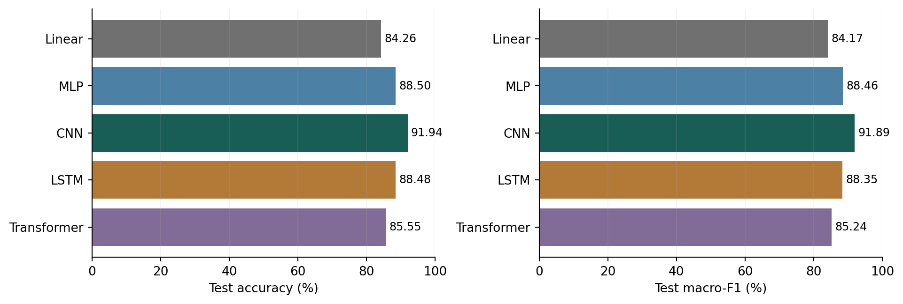

*Figure 5. Official-test accuracy and macro-F1, both displayed as percentages. Axes start at zero. These are single-run scores, without repeated-seed error bars.*

MLP and LSTM are almost tied: their test accuracies differ by 0.02 percentage points, or two images. This is too small to support a stable ranking without repeated runs. Their macro-F1 values are also close, although their class-level mistakes differ.

The Transformer obtains 85.55% test accuracy, 1.29 percentage points above Linear and below the other nonlinear models. This result describes the small, two-block patch model trained for ten epochs. It does not establish that attention-based image models are generally weaker than CNNs or MLPs.

Because the test set has equal class support, weighted F1 and macro-F1 are identical here. Accuracy and macro-F1 remain different measures: F1 also depends on how false positives are distributed across classes.

## 4.2 Learning behavior and checkpoint selection

Figure 6 shows the recorded training and validation losses for all ten epochs. The same vertical scale is used for every model.

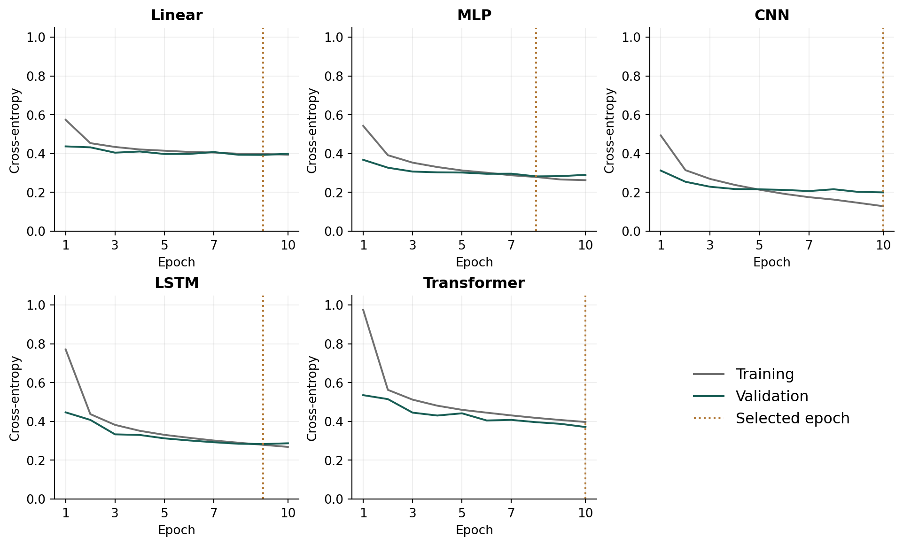

*Figure 6. Cross-entropy over ten epochs. Dotted lines mark the checkpoint with the lowest validation loss. Training loss is collected with dropout active and changing weights; validation loss uses evaluation mode after each epoch.*

<div id="tab:history">

| Model | Val. loss, epoch 1 | Val. loss, epoch 10 | Train acc. (%) | Val. acc. (%) |
|:---|---:|---:|---:|---:|
| Linear | 0.4373 | 0.3993 | 86.17 | 86.15 |
| MLP | 0.3680 | 0.2906 | 90.19 | 89.65 |
| CNN | 0.3124 | 0.2001 | 95.19 | 93.28 |
| LSTM | 0.4469 | 0.2874 | 90.15 | 89.40 |
| Transformer | 0.5355 | 0.3713 | 85.47 | 86.43 |

Table 9. First and final validation losses, with final-epoch accuracies. These final-epoch values need not belong to the selected checkpoint.

</div>

All five models reduce validation loss between the first and last epochs. Linear changes relatively little after its early improvement and selects epoch 9. MLP selects epoch 8: its training loss continues to decrease, but its validation loss rises from 0.2825 at epoch 8 to 0.2906 at epoch 10. LSTM selects epoch 9 and also shows a small validation-loss increase at epoch 10. These patterns support keeping the best checkpoint rather than automatically using the last one.

CNN and Transformer select epoch 10. The Transformer is still improving at the budget boundary, so the available run cannot show whether a longer schedule would close the gap. For CNN, the final training accuracy is 95.19% and validation accuracy is 93.28%, indicating a gap on these recorded metrics.

Validation loss can be lower than training loss, especially early in a run. Dropout is disabled during validation, and validation uses weights after the epoch rather than the changing weights seen throughout training. The two curves should therefore not be treated as identical measurement conditions.

## 4.3 Model size and computational cost

<div id="tab:runtime">

| Model       | Parameters | Train (s) | Train device | Forward (ms) | Test pass (s) |
|:------------|-----------:|----------:|:-------------|-------------:|--------------:|
| Linear      |      7,850 |     90.85 | CUDA         |        0.060 |         1.110 |
| MLP         |    235,146 |     96.69 | CUDA         |        0.326 |         1.410 |
| CNN         |    421,642 |    105.03 | CUDA         |        1.074 |         1.382 |
| LSTM        |     82,186 |    122.12 | CUDA         |        1.189 |         1.237 |
| Transformer |     71,946 |    139.45 | CUDA         |        2.061 |         1.595 |

Table 10. Parameter count and recorded CUDA runtime on GTX 1660 SUPER. Linear and MLP costs use separate CUDA repetitions of the baseline protocol. Forward time covers one 128-image device-resident batch on GTX 1660 SUPER. Test-pass time covers all 10,000 images, including loading, transfers, loss and prediction collection.

</div>

Linear is the smallest model, with 7,850 parameters, and has the shortest recorded forward time. MLP uses 235,146 parameters. CNN has 421,642 parameters and takes 1.074 milliseconds per batch. The CNN’s accuracy gain therefore comes with greater model size and forward cost compared with these baselines.

LSTM and Transformer are smaller than the MLP, with 82,186 and 71,946 parameters, but their recorded forward times are longer. Parameter count alone does not describe execution cost. The LSTM processes 28 recurrent steps, and the Transformer applies attention and feedforward operations to 49 tokens. Kernel implementation and the chosen batch size also affect runtime.

### Interpreting training time

All five training durations in Table 10 were measured on CUDA using the GTX 1660 SUPER. Linear and MLP were retrained with the same seed 42, 54,000/6,000 split, normalization, batch size 128, Adam learning rate 0.001, and ten-epoch budget. Their new checkpoints and evaluations are saved under `runs/cuda_baselines`. The original baseline runs are retained for the classification tables and error analysis. These two repetitions measure computational cost and do not replace the original accuracy results.

For the other three CUDA runs, recorded training durations are 105.03 seconds for CNN, 122.12 seconds for LSTM and 139.45 seconds for Transformer. These are the observed durations for the shared ten-epoch budget, not estimates of average runtime across repeated trials. The runs were recorded in separate sessions; common hardware does not remove variation from system load or GPU clocks.

### Interpreting inference time

All five saved inference measurements use the GTX 1660 SUPER, batch size 128, ten warm-up calls and 100 timed forward calls. The data is already on the GPU. The reported batch time excludes loading and host-to-device transfers. For CNN, 1.074 milliseconds per batch corresponds to approximately 0.00839 milliseconds per image *within that batch*. It is not the latency of a single-image request.

The complete test pass includes the additional work shared by the evaluation pipeline. Because the forward and test-pass timers cover different operations, they should not be subtracted to estimate an exact loading overhead.

The saved summaries do not contain model-specific peak GPU memory or energy measurements. Parameter counts are reported directly, without treating them as a substitute for those missing resource measurements.

# 5 Error Analysis

## 5.1 Performance by class

The overall scores conceal substantial variation among categories. Figure 7 compares the per-class F1 values of all five models. The full numerical table is included in Appendix A.

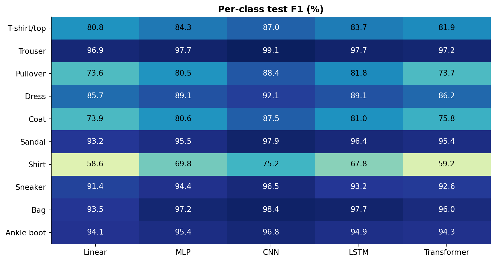

*Figure 7. Per-class F1 on the official test set, shown as percentages. Every class has 1,000 test images.*

Shirt has the lowest F1 for every model. Its score rises from 58.59% for Linear to 69.76% for MLP and 75.18% for CNN. Transformer reaches 59.20%, which is close to Linear on this class despite its higher overall score.

CNN has the highest F1 for each of the ten classes in the recorded runs. Its improvement over MLP is particularly clear for Pullover (80.54% to 88.43%) and Coat (80.65% to 87.45%). For Trouser, both models already perform well, so the gain is smaller.

The LSTM’s aggregate result is close to the MLP’s, but it has higher F1 on Pullover, Coat, Sandal and Bag, and lower F1 on Shirt and Sneaker. For example, LSTM obtains 96.40% F1 on Sandal versus 95.50% for MLP, but 67.84% on Shirt versus 69.76%. The near tie in accuracy therefore does not mean the two models make the same decisions.

These results broadly agree with the visual observations in Section 2: upper-body categories are difficult to separate, while trousers and several accessory or footwear categories are easier. However, class-average similarity is only a descriptive summary. Models predict individual images, whose shapes and textures can differ substantially from the average.

## 5.2 Confusion patterns in the CNN

Figure 8 shows the CNN’s confusion matrix. Rows are true labels and columns are predicted labels. Each row contains 1,000 images.

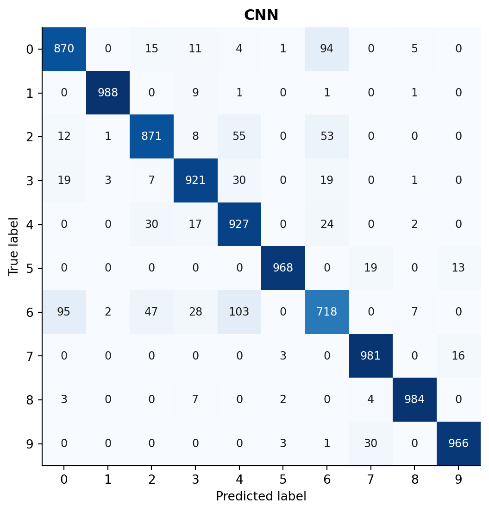

*Figure 8. CNN test confusion counts. Label IDs follow Table 1. The diagonal contains correct predictions.*

<div id="tab:confusion_pairs">

| Class A     | Class B | A predicted as B | B predicted as A |
|:------------|:--------|-----------------:|-----------------:|
| T-shirt/top | Shirt   |               94 |               95 |
| Coat        | Shirt   |               24 |              103 |
| Pullover    | Shirt   |               53 |               47 |
| Pullover    | Coat    |               55 |               30 |
| Dress       | Shirt   |               19 |               28 |
| Dress       | Coat    |               30 |               17 |

Table 11. Six CNN class pairs with the largest combined two-way confusion. The two directions are counted separately.

</div>

Of the CNN’s 806 mistakes, 532 occur between the four labels T-shirt/top, Pullover, Coat and Shirt. These account for 66.0% of all errors. Shirt alone has 282 incorrect predictions: 103 become Coat, 95 become T-shirt/top and 47 become Pullover.

The confusions are not always symmetric. There are 103 Shirt-to-Coat errors but only 24 Coat-to-Shirt errors. CNN recalls 92.7% of Coat images, yet its Coat precision is lower, at 82.77%, because other garments are also predicted as Coat. This distinction explains why recall alone would give an incomplete view of the class.

## 5.3 Individual predictions and shared errors

Figure 9 displays four correct and four incorrect CNN predictions. A seeded generator selects from the correct set and then the incorrect set. The deliberately balanced display illustrates behavior; it does not represent the model’s actual error frequency.

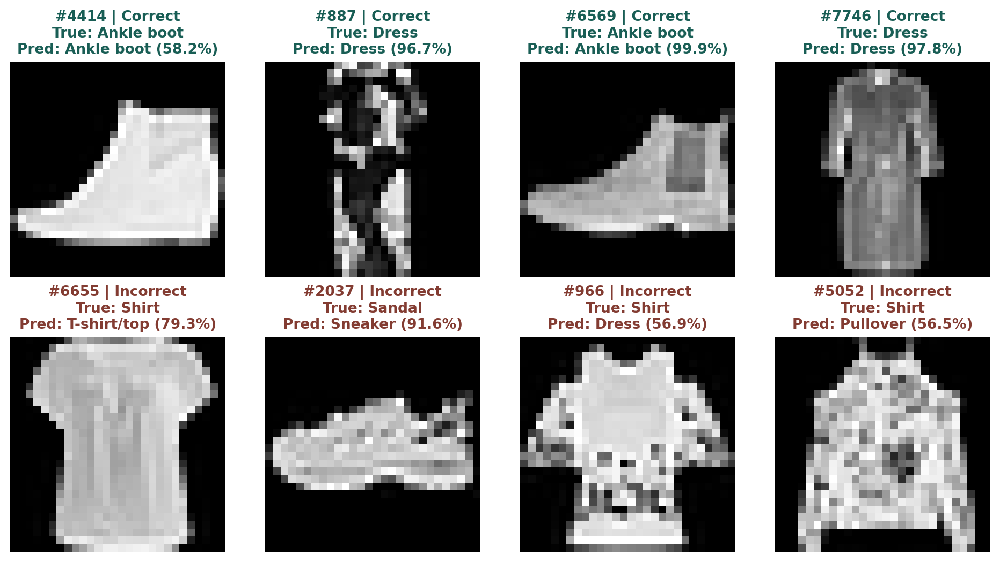

*Figure 9. CNN examples from the official test set, sampled with seed 42. Indices are zero-based test indices. The percentage is the maximum softmax score, not a calibrated probability of correctness.*

Image \#6655 has a short-sleeved outline and is labeled Shirt, but is predicted as T-shirt/top. Image \#5052 is also Shirt and is predicted as Pullover. These examples illustrate the upper-body confusion counted in the matrix. The images alone cannot reveal the model’s internal reason for each decision.

The Sandal image \#2037 is predicted as Sneaker with a score of 91.6%. In contrast, the correctly classified Ankle boot \#4414 has a score of 58.2%. High confidence can accompany an error, and moderate confidence can accompany a correct prediction. The study does not include a calibration experiment.

<div id="tab:paired">

| Compared with CNN | CNN only correct | Other only correct | Both wrong |
|:------------------|-----------------:|-------------------:|-----------:|
| Linear            |              998 |                230 |        576 |
| MLP               |              566 |                222 |        584 |
| LSTM              |              621 |                275 |        531 |
| Transformer       |              874 |                235 |        571 |

Table 12. Paired correctness on the same 10,000 test images. “Only” means the named model is correct and the other is wrong.

</div>

CNN corrects 566 images that MLP gets wrong, but MLP correctly handles 222 images that CNN misses. The net difference is the 344-image advantage in Table 8. MLP and LSTM also differ on individual cases: MLP alone is correct on 360 images and LSTM alone on 358, producing their two-image net gap. All five models are wrong on 389 shared images.

These complementary decisions motivate future ensemble experiments, but no ensemble has been trained or evaluated here. The paired counts describe agreement and disagreement; they are not an achieved ensemble score.

# 6 Discussion and Limitations

## 6.1 What the comparison shows

The strongest result comes from the CNN. Its local filters and pooling provide a natural way to process the spatial structure of clothing images. The class-level results show gains across all categories, including the similar upper-body garments that trouble the baselines. This is consistent with the usefulness of local spatial features in this task.

That explanation remains an interpretation. The CNN also has the largest parameter count, and no ablation isolates the contribution of convolution, pooling, width or regularization. The experiment demonstrates a better result for this configuration, rather than proving a single cause for the improvement.

The MLP is a useful practical baseline. It improves substantially over Linear and nearly matches the LSTM while requiring less recorded forward time. The LSTM achieves similar overall accuracy with fewer parameters, but reading the image sequentially does not provide an accuracy advantage in this run. Its final hidden state must summarize the rows before classification.

The Transformer has the fewest parameters among the four nonlinear models, but it has the longest recorded forward time and a lower test score than MLP, CNN or LSTM. Attention is not automatically an improvement under a small, fixed training configuration. Since its validation loss is still decreasing at epoch 10, longer training is a plausible follow-up, not an established remedy.

## 6.2 Limits of the evidence

1.  **One seed per model.** The report does not estimate variation from initialization or data ordering. Small score differences, especially between MLP and LSTM, should not be treated as stable.

2.  **Unequal capacity and computation.** The models share an epoch budget but have different parameter counts, operations and training durations. The study is not a capacity-matched or compute-matched ablation.

3.  **Restricted optimization.** There is no systematic learning-rate, width, dropout or schedule search. A shared setting may suit some models better than others, and ten epochs need not be sufficient for every configuration.

4.  **Hardware and timing scope.** All cost measurements use CUDA on the GTX 1660 SUPER. Baseline costs come from separate repetitions; classification scores retain the original checkpoints. Inference uses only one batch size and a short benchmark, without repeated-session timing variation. Peak model memory is not recorded.

5.  **Limited image domain.** Fashion-MNIST contains small grayscale images. The experiment does not measure robustness to color, backgrounds, occlusion, new product styles or distribution shift.

6.  **Post-evaluation analysis.** Confusions and example images explain the existing results. They do not justify tuning against the test set and reporting the same set as an untouched final evaluation.

## 6.3 Next experiments

The first priority is to repeat each configuration across several seeds and report the mean and variation of accuracy and macro-F1. Training-speed comparisons should repeat all five models in controlled sessions on the same hardware and timing scope to quantify runtime variation.

Next, use validation data to compare longer schedules and modest learning-rate changes, especially for Transformer. Separate ablations can examine CNN width, LSTM readout and patch size while controlling one factor at a time. Augmentation and calibration are further candidates. Any new settings should be selected through validation before a clearly documented final evaluation.

# 7 Conclusion

This project compares five neural network configurations through a common Fashion-MNIST pipeline. The data is split into fixed training, validation and test partitions, normalized using training statistics, and presented as vectors, image grids, row sequences or patch sequences. All models use the same ten-epoch training budget and validation-loss checkpoint rule.

The CNN gives the strongest recorded result: 91.94% test accuracy and 0.9189 macro-F1. It makes 806 errors on 10,000 images, 344 fewer than the MLP. Its improvement appears across all ten class F1 scores, although Shirt remains difficult, with 71.8% recall. Most remaining CNN errors occur among T-shirt/top, Pullover, Coat and Shirt.

MLP and LSTM obtain nearly equal accuracy at 88.50% and 88.48%. Their two-image difference is too small to support a general ranking, and their individual predictions differ substantially. Transformer reaches 85.55%, above the Linear baseline at 84.26%, but below the other nonlinear models under this configuration and training budget.

For this assignment, CNN is the preferred configuration when test accuracy is the main criterion. MLP is a useful alternative when the recorded forward cost matters: it trades some accuracy for a substantially shorter batch forward time. LSTM is smaller than MLP in parameter count, but that smaller count does not translate into faster measured inference.

The broader lesson is that a more elaborate architecture does not guarantee a better result under a fixed experimental budget. Input structure, capacity, optimization and runtime must be considered together. Repeated seeds and controlled follow-up experiments are needed before these single-run findings can be extended into stronger claims.

| Finding | Evidence in this study |
|:---|:---|
| CNN leads in predictive quality | 91.94% accuracy, 0.9189 macro-F1 and the highest F1 in each class. |
| MLP and LSTM are nearly tied | 88.50% versus 88.48% accuracy; no repeated-seed estimate. |
| Upper-body garments remain difficult | 532 of the CNN’s 806 errors occur within four upper-body labels. |
| Parameter count does not rank runtime | LSTM and Transformer are smaller than MLP but have longer forward times. |
| Broader conclusions need more runs | One seed, different capacities and separate timing sessions. |

Table 13. Main findings and the evidence that supports them.

# References

1.  H. Xiao, K. Rasul and R. Vollgraf. *Fashion-MNIST: a Novel Image Dataset for Benchmarking Machine Learning Algorithms*. 2017. [arXiv:1708.07747](https://arxiv.org/abs/1708.07747).

2.  Zalando Research. *Fashion-MNIST dataset repository*. Dataset files, labels, checksums and license. <https://github.com/zalandoresearch/fashion-mnist>. Accessed 20 October 2026.

3.  Y. LeCun, L. Bottou, Y. Bengio and P. Haffner. “Gradient-Based Learning Applied to Document Recognition.” *Proceedings of the IEEE*, 86(11), 2278–2324, 1998. <https://bottou.org/papers/lecun-98h>.

4.  S. Hochreiter and J. Schmidhuber. “Long Short-Term Memory.” *Neural Computation*, 9(8), 1735–1780, 1997. <https://doi.org/10.1162/neco.1997.9.8.1735>.

5.  A. Vaswani et al. *Attention Is All You Need*. 2017. [arXiv:1706.03762](https://arxiv.org/abs/1706.03762).

6.  A. Dosovitskiy et al. *An Image is Worth 16x16 Words: Transformers for Image Recognition at Scale*. 2020. [arXiv:2010.11929](https://arxiv.org/abs/2010.11929).

7.  D. P. Kingma and J. Ba. *Adam: A Method for Stochastic Optimization*. 2015. [arXiv:1412.6980](https://arxiv.org/abs/1412.6980).

# A Detailed Class Results

| Class       | Linear |   MLP |   CNN |  LSTM | Transformer |
|:------------|-------:|------:|------:|------:|------------:|
| T-shirt/top |  80.81 | 84.27 | 87.04 | 83.66 |       81.91 |
| Trouser     |  96.86 | 97.67 | 99.10 | 97.73 |       97.20 |
| Pullover    |  73.58 | 80.54 | 88.43 | 81.84 |       73.74 |
| Dress       |  85.69 | 89.14 | 92.05 | 89.14 |       86.20 |
| Coat        |  73.93 | 80.65 | 87.45 | 81.04 |       75.83 |
| Sandal      |  93.24 | 95.50 | 97.93 | 96.40 |       95.36 |
| Shirt       |  58.59 | 69.76 | 75.18 | 67.84 |       59.20 |
| Sneaker     |  91.38 | 94.44 | 96.46 | 93.17 |       92.59 |
| Bag         |  93.54 | 97.24 | 98.40 | 97.73 |       96.00 |
| Ankle boot  |  94.08 | 95.38 | 96.84 | 94.95 |       94.34 |

Table 14. Per-class test F1 (%). Each class has 1,000 test images. Values are rounded to two decimal places.

| Class       | Precision | Recall |    F1 | Errors |
|:------------|----------:|-------:|------:|-------:|
| T-shirt/top |     87.09 |  87.00 | 87.04 |    130 |
| Trouser     |     99.40 |  98.80 | 99.10 |     12 |
| Pullover    |     89.79 |  87.10 | 88.43 |    129 |
| Dress       |     92.01 |  92.10 | 92.05 |     79 |
| Coat        |     82.77 |  92.70 | 87.45 |     73 |
| Sandal      |     99.08 |  96.80 | 97.93 |     32 |
| Shirt       |     78.90 |  71.80 | 75.18 |    282 |
| Sneaker     |     94.87 |  98.10 | 96.46 |     19 |
| Bag         |     98.40 |  98.40 | 98.40 |     16 |
| Ankle boot  |     97.09 |  96.60 | 96.84 |     34 |

Table 15. CNN class metrics. Precision, recall and F1 are percentages. Errors count true-class images assigned another label.

For class $`k`$, precision is $`TP_k/(TP_k+FP_k)`$ and recall is $`TP_k/(TP_k+FN_k)`$. The CNN’s Shirt recall is 71.80%, meaning it correctly classifies 718 of the 1,000 Shirt images. Its Shirt precision is 78.90%, meaning that some images predicted as Shirt actually belong to another class.

The exact values are recomputed from the saved confusion counts before rounding. All classes have equal support, so the mean class recall equals overall accuracy. This equality does not make precision or F1 redundant.

# B Additional Confusion Matrices

The matrices below use the same label mapping and color range as the CNN matrix. Rows are true labels and columns are predictions. Each row sums to 1,000 and each complete matrix contains 10,000 predictions.

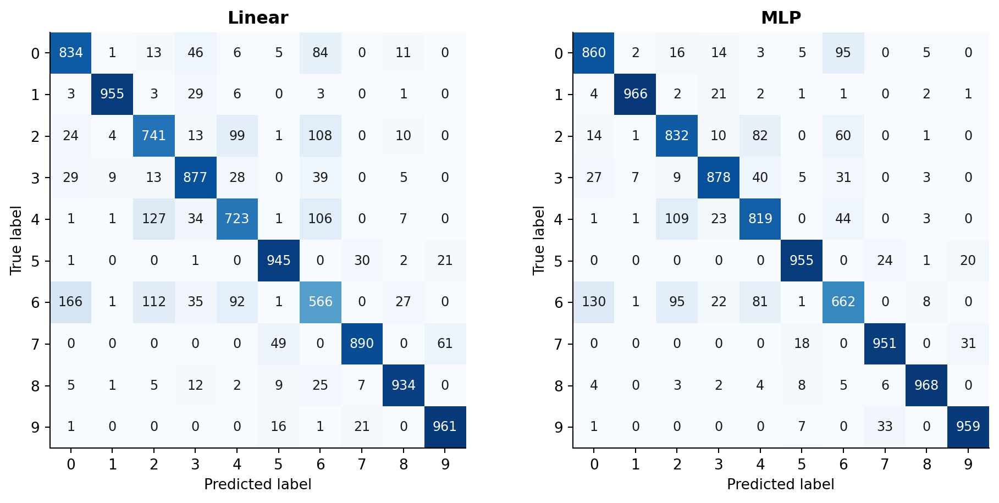

*Figure 10. Official-test confusion matrices for the Linear and MLP baselines.*

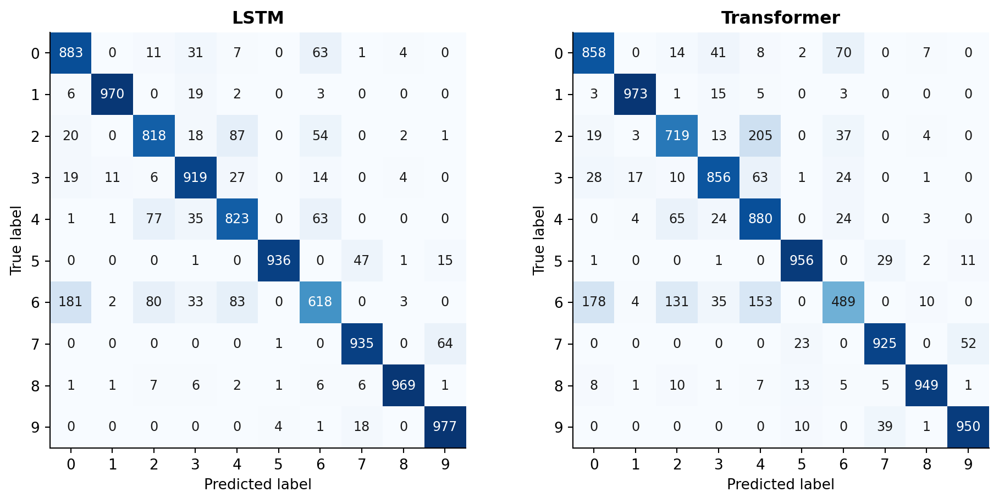

*Figure 11. Official-test confusion matrices for the row LSTM and patch Transformer.*

Labels: 0 T-shirt/top; 1 Trouser; 2 Pullover; 3 Dress; 4 Coat; 5 Sandal; 6 Shirt; 7 Sneaker; 8 Bag; 9 Ankle boot.

# C Reproducibility and Evidence

## C.1 Environment and saved files

The CUDA training and test-evaluation records identify Windows 11, Python 3.12.10, PyTorch 2.9.1+cu128, torchvision 0.24.1+cu128, NumPy 2.2.6 and scikit-learn 1.7.2. The GPU is an NVIDIA GeForce GTX 1660 SUPER with 6 GiB of memory. Linear and MLP computational costs now come from separate CUDA training and test runs; the original selected checkpoints remain the source of classification scores and error analysis.

From the repository’s `A1` folder, the principal files are:

| Path | Role |
|:---|:---|
| `a1/data.py` | Split, normalization and input arrangements. |
| `a1/models.py` | Definitions of all five classifiers. |
| `a1/train.py` | Training loop and checkpoint selection. |
| `a1/evaluate.py` | Test evaluation, predictions and timing. |
| `split_cache.json` | Fixed indices, hashes and normalization values. |
| `runs/m1/linear`, `runs/m1/mlp` | Baseline training and test artifacts. |
| `runs/cuda_baselines/linear`, `mlp` | Separate CUDA baseline cost measurements. |
| `runs/m2/cnn`, `lstm`, `transformer` | Three model directories under `runs/m2`. |
| `report/data/eda_metrics.json` | Training-data statistics and integrity checks. |

Table 16. Implementation and experiment evidence.

Each run stores a checkpoint, epoch history, training and test summaries, prediction CSV, confusion matrix and verification record. The test summary’s checkpoint SHA-256 associates its metrics with the exact saved weights.

## C.2 Commands to reproduce the experiment

Create a Python 3.12 environment and install `requirements-windows.txt` on the CUDA reference platform. For example, run the following from `A1` in PowerShell:

    py -3.12 -m venv .venv
    .\.venv\Scripts\python.exe -m pip install -r requirements-windows.txt
    $env:CUBLAS_WORKSPACE_CONFIG = ':4096:8'
    .\.venv\Scripts\python.exe -m unittest discover -s tests -v
    .\.venv\Scripts\python.exe -m a1.train --model cnn --config configs/cnn.json
    .\.venv\Scripts\python.exe -m a1.evaluate --checkpoint runs/m2/cnn/best.pt
    .\.venv\Scripts\python.exe tests/verify_run.py --model cnn

Linear and MLP use `configs/m1.json`; LSTM and Transformer use `configs/lstm.json` and `configs/transformer.json`. Change the model name and checkpoint directory accordingly. To reproduce the baseline CUDA cost repetitions without replacing the original run files, execute the following from `A1`:

    .\.venv\Scripts\python.exe -m a1.cuda_baselines

This uses `configs/m1_cuda.json`, which explicitly requires CUDA and writes to `runs/cuda_baselines`. It trains both baselines, evaluates their selected checkpoints on CUDA and verifies all saved test predictions.

## C.3 Checks performed for this report

Report checks recompute metrics and confusion counts for all 50,000 original test predictions and verify checkpoint selection, normalization, data hashes and file digests.

Both new CUDA baseline checkpoints pass validation/test metric recomputation, verification of all 20,000 saved predictions and CPU/CUDA agreement on 128 images per model. Records accompany the checkpoints. Losses and timings use saved summaries; report evidence and document checks are in `qa`.
