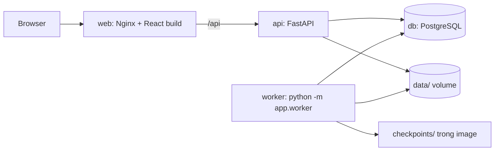

# A2 → Sleep EEG Web App — kế hoạch MVP

Nguyên tắc: **dựng một lát cắt dọc chạy được end-to-end trước** (upload → inference → xem kết quả → test tự động), hạ tầng vận hành (domain, OTP, backup, monitoring) làm sau khi MVP xong.

## 1. Mục tiêu và phạm vi

Dự án phục vụ hai mục tiêu:

1. **Công cụ nghiên cứu:** upload EDF Sleep-EDF, chạy Transformer hoặc AttnSleep đã huấn luyện ở A2, xem hypnogram/waveform/xác suất, so sánh hai model, tải kết quả.
2. **Bằng chứng kỹ năng software cho CV:** frontend, backend, automation testing, CI và container, mỗi phần đều có code và test kiểm chứng được trong repo.

### MVP hoàn thành khi

Clone mới → `docker compose up --build` → mở `http://localhost:8080` → chọn recording mẫu hoặc upload EDF hợp lệ → chạy cả hai model → xem và so sánh → tải CSV. Job không mất khi restart, CI xanh gồm cả Playwright, README có ảnh chụp và sơ đồ kiến trúc.

### Quyết định

**Giữ nguyên:** hai model (Transformer, AttnSleep) với soft voting năm fold; đầu vào Sleep-EDF 100 Hz, hai kênh Fpz-Cz và Pz-Oz; preprocessing không dùng nhãn; PostgreSQL; React + TypeScript + Vite; TanStack Query; ECharts; Docker Compose; UI và tài liệu kỹ thuật bằng tiếng Anh. Host trên MacBook, Cloudflare Tunnel và email OTP vẫn giữ nhưng chuyển sang sau MVP (mục 9).

**Thay đổi so với bản trước:**

| Chủ đề | Bản trước | Bản này | Lý do |
|---|---|---|---|
| Thư mục gốc | `A2/production/` | `A2/webapp/` | `production` là tên môi trường, không phải tên sản phẩm; `app` thì trùng với package FastAPI bên trong |
| Python package | `backend/src/sleep_app/` | `backend/app/` | Quy ước FastAPI: `fastapi dev app/main.py` chạy không cần cấu hình |
| Dữ liệu runtime | `var/` | `data/` | Cùng ý nghĩa, tên dễ hiểu hơn (xem mục 3) |
| Checkpoints | `var/model-releases/`, git-ignored | `backend/checkpoints/`, commit vào Git (≈22 MB) | Clone về chạy được ngay; CI và Docker build không cần bước tải riêng |
| Job queue | RQ + Redis | Bảng `jobs` trong PostgreSQL + một worker process | Một job mỗi lần trên một host: bớt một dịch vụ, chỉ còn một nguồn trạng thái |
| Upload | Bốn endpoint, chia 8 MiB, resume | Một request multipart, tối đa 64 MiB | PSG lớn nhất ≈50 MiB, dưới giới hạn 100 MB/request của Cloudflare |
| Auth | Xác minh Cloudflare JWT ngay từ đầu | Dependency `get_current_user` hai chế độ: `dev` (MVP), `cloudflare` (sau MVP) | Quyền sở hữu có trong data model từ đầu mà không chặn tiến độ |
| Docker image | Tách image API và worker | Một image backend, hai command | API không import `torch` nên RAM vẫn nhỏ; chỉ phải build một lần |
| Playwright | Ghi nhầm ở dòng Backend | E2E bằng TypeScript trong `frontend/tests/` | Playwright kiểm thử giao diện, không phải thành phần backend |
| Thứ tự | Frontend ở giai đoạn 3, test/CI ở giai đoạn 5 | CI và Playwright có từ M0 | Mỗi milestone đều demo được và có test |

### Ngoài phạm vi MVP

| Hạng mục | Làm khi |
|---|---|
| Cloudflare Tunnel + Access, xác minh JWT | P1, ngay sau MVP |
| Backup `pg_dump`, benchmark recording 24 giờ | P1, trước khi mời người dùng thật |
| Upload chia phần/resume | Cần nhận file trên 100 MB |
| Redis + RQ | Cần nhiều worker hoặc nhiều host |
| Waveform toàn đêm giảm mật độ | Sau khi viewer theo epoch đã ổn |
| Báo cáo PDF, retention 30 ngày, trang quản trị, uptime check, restic/R2 | Có người dùng ngoài nhóm |
| Qdrant, CNN/CBraMod, training CLI | Sau v1 |

---

## 2. Kiến trúc và tech stack

Bốn dịch vụ trong Compose: `web`, `api`, `worker`, `db`.



| Thành phần | Lựa chọn | Vai trò |
|---|---|---|
| Frontend | React + TypeScript + Vite, React Router, Tailwind CSS | Recordings, upload, màn hình kết quả |
| Server state | TanStack Query | Gọi API, polling job, cache |
| API client | `openapi-typescript` + `openapi-fetch` | Types sinh từ OpenAPI của FastAPI |
| Visualization | Apache ECharts | Hypnogram, waveform, xác suất, confusion matrix |
| Backend | FastAPI + Pydantic v2 | API, validation, authorization, OpenAPI |
| Database | PostgreSQL + SQLAlchemy 2 + Alembic | Recordings, jobs, predictions |
| Background job | Worker process đọc bảng `jobs` | Preprocessing và inference |
| ML runtime | PyTorch (CPU) + MNE + NumPy + SciPy + scikit-learn | Xử lý tín hiệu, chạy checkpoint, metrics |
| Packaging | `uv` + `uv.lock`, `npm` + `package-lock.json` | Khóa dependency |
| Test | pytest, Playwright (`@playwright/test`) | Unit, API, parity, E2E |
| CI | GitHub Actions | Lint, test, build, E2E trên Compose stack |
| Deployment | Docker Compose | Chạy toàn bộ dịch vụ |

**Vì sao chưa cần Redis:** worker lấy job bằng `SELECT … FOR UPDATE SKIP LOCKED` trên bảng `jobs`. Trạng thái job chỉ nằm ở PostgreSQL nên không phải đồng bộ hai nơi, và restart không làm mất hàng đợi. RQ còn fork process cho mỗi job, dễ lỗi với PyTorch khi chạy trực tiếp trên macOS lúc development.

**Lưu ý build:** cài `torch` từ CPU index của PyTorch (cấu hình trong `pyproject.toml`), nếu không bản Linux x86-64 trên CI sẽ kéo theo vài GB thư viện CUDA. Giữ Python 3.12 và `torch` cùng minor version với run nghiên cứu (2.14).

---

## 3. Cấu trúc thư mục và naming

```text
A2/
├── model_lib.py, attnsleep.py, preprocessing.py   # Code nghiên cứu: không sửa, dùng làm reference cho parity
├── runs/                                          # Kết quả và checkpoints gốc
└── webapp/
    ├── README.md
    ├── .env.example
    ├── compose.yaml
    ├── backend/
    │   ├── pyproject.toml
    │   ├── uv.lock
    │   ├── Dockerfile
    │   ├── alembic.ini
    │   ├── alembic/versions/
    │   ├── app/
    │   │   ├── main.py                  # Tạo FastAPI app, gắn router
    │   │   ├── worker.py                # Vòng lặp lấy và chạy job
    │   │   ├── models.py                # SQLAlchemy ORM
    │   │   ├── schemas.py               # Pydantic request/response
    │   │   ├── core/
    │   │   │   ├── config.py            # Settings(BaseSettings)
    │   │   │   ├── db.py                # Engine, session
    │   │   │   └── security.py          # Xác định người dùng hiện tại
    │   │   ├── api/
    │   │   │   ├── main.py              # api_router gom các routes
    │   │   │   ├── deps.py              # SessionDep, CurrentUser
    │   │   │   └── routes/
    │   │   │       ├── recordings.py
    │   │   │       ├── jobs.py
    │   │   │       ├── models.py        # Danh sách model releases
    │   │   │       └── health.py
    │   │   ├── services/
    │   │   │   ├── edf.py               # Đọc header, validate, parse hypnogram
    │   │   │   ├── storage.py           # Đường dẫn file trong data/
    │   │   │   ├── metrics.py
    │   │   │   └── exports.py
    │   │   └── ml/
    │   │       ├── preprocessing.py
    │   │       ├── inference.py
    │   │       ├── registry.py          # Đọc manifest, kiểm SHA-256
    │   │       ├── cli.py               # python -m app.ml.cli infer …
    │   │       └── networks/
    │   │           ├── transformer.py
    │   │           ├── attnsleep.py     # Adapter
    │   │           └── attnsleep_author.py   # Code tác giả + MIT license, giữ nguyên
    │   ├── checkpoints/
    │   │   ├── transformer-a2-v1/       # manifest.json, fold_1.pt … fold_5.pt
    │   │   └── attnsleep-a2-v1/
    │   ├── scripts/
    │   │   ├── package_checkpoints.py   # Copy từ A2/runs, ghi manifest
    │   │   └── fetch_sample.py          # Tải recording mẫu từ PhysioNet
    │   └── tests/
    │       ├── unit/
    │       ├── api/
    │       ├── parity/
    │       └── fixtures/                # EDF đã cắt ngắn cho CI
    ├── frontend/
    │   ├── package.json
    │   ├── package-lock.json
    │   ├── Dockerfile
    │   ├── nginx.conf
    │   ├── playwright.config.ts
    │   ├── src/
    │   │   ├── api/                     # schema.d.ts sinh tự động + client
    │   │   ├── pages/
    │   │   ├── components/
    │   │   ├── charts/
    │   │   └── lib/
    │   └── tests/
    │       ├── e2e/                     # *.spec.ts
    │       └── pages/                   # Page objects
    └── data/                            # Git-ignored, tạo lúc chạy
        └── recordings/<recording_id>/   # source.edf, hypnogram.edf, display_100hz.npy
```

Workflow CI phải nằm ở gốc repo: `.github/workflows/webapp.yml`, lọc theo `paths: A2/webapp/**`.

**`data/` là gì:** nơi chứa mọi thứ ứng dụng *ghi ra khi chạy* (EDF người dùng upload, waveform đã xử lý), tách khỏi code. Bản trước gọi là `var/` theo quy ước Unix (`/var` = "variable data"). Thư mục này không commit, được mount thành Docker volume để dữ liệu còn sau khi restart. `A2/.gitignore` đã bỏ qua `data/`.

**`checkpoints/` khác `data/`:** trọng số model là artifact cố định, chỉ đọc, đi cùng phiên bản code, nên nằm trong backend và được copy vào image.

### Naming convention

| Đối tượng | Quy ước | Ví dụ |
|---|---|---|
| Router file | Danh từ số nhiều theo resource, trong `api/routes/` | `recordings.py`, `jobs.py` |
| URL | Danh từ số nhiều, không động từ, prefix `/api/v1` | `/api/v1/recordings/{recording_id}` |
| Path parameter | Có tên resource, không dùng `{id}` trần | `{recording_id}`, `{job_id}`, `{epoch_index}` |
| Hàm route | `động_từ_danh_từ`, snake_case | `list_recordings`, `create_recording`, `read_recording`, `delete_recording`, `create_job` |
| Pydantic schema | `<Resource><Vai trò>` | `RecordingPublic`, `JobCreate`, `JobPublic`, `MetricsPublic` |
| ORM class / bảng | Số ít PascalCase / số nhiều snake_case | `Recording` → `recordings` |
| Dependency | Alias `Annotated` trong `api/deps.py` | `SessionDep`, `CurrentUser` |
| Settings | Một class trong `core/config.py`, biến môi trường UPPER_SNAKE | `DATABASE_URL`, `AUTH_MODE`, `DATA_DIR` |
| JSON field | snake_case; frontend dùng nguyên types sinh ra, không đổi sang camelCase | `recording_id`, `n_epochs` |
| Lỗi nghiệp vụ | `{"detail": {"code", "message"}}`, code UPPER_SNAKE | `EDF_MISSING_CHANNEL` |

Chữ "model" có ba nghĩa, mỗi nghĩa một chỗ: `models.py` là ORM; `ml/networks/` là kiến trúc mạng; `checkpoints/` là trọng số. Trên API và UI, `models` nghĩa là model release (`transformer-a2-v1`).

Đặt `generate_unique_id_function` để `operationId` ngắn gọn (`recordings-list_recordings`) thay vì tên mặc định dài của FastAPI.

---

## 4. ML: kế thừa A2, inference và parity

### Kế thừa

- Copy đúng các class cần cho hai model: `TemporalConvEmbedding`, `MultiHeadSelfAttention`, `TransformerEncoderLayer`, `Transformer` từ `model_lib.py`; `attnsleep.py` giữ nguyên văn kèm MIT license; adapter `AttnSleep(channel_index=0)`.
- Không đổi tên attribute nào, để `load_state_dict(strict=True)` chạy được. Load bằng `torch.load(weights_only=True)`.
- Web app không gọi notebook hay `start_run()`: hàm này xóa và ghi lại thư mục run.

### Model release

`scripts/package_checkpoints.py` copy mười file từ `A2/runs/<model>/sleep_waveform_final/` và ghi `manifest.json` gồm: model ID, constructor kwargs (từ `A2/configs/*.json`), thứ tự lớp `[W, N1, N2, N3, REM]`, SHA-256 từng fold, tham số preprocessing, và metrics test đã công bố (Transformer: accuracy 0.799, macro-F1 0.756; AttnSleep: 0.797 và 0.751).

Release là bất biến. Train lại thì tạo thư mục mới (`transformer-a2-v2`); mỗi job lưu `model_id` đã dùng.

### Preprocessing phục vụ inference

- Đọc EDF với `include=["EEG Fpz-Cz", "EEG Pz-Oz"]`, yêu cầu 100 Hz, từ chối dữ liệu NaN/Inf.
- Giữ nguyên chuỗi xử lý của `prepare_waveforms`: FIR 0.3–35 Hz trên toàn recording, `resample_poly` 100→200 Hz, scale µV/100.
- Cắt cửa sổ 30 giây liên tiếp từ đầu recording: `n_epochs = floor(duration / 30)`. Báo rõ số giây dư bị bỏ.
- **Không đọc hypnogram ở bước này.** Thêm hay đổi nhãn không được làm thay đổi dự đoán.
- Một tensor `(N, 2, 30, 200)` dùng cho cả hai model; adapter AttnSleep tự chọn Fpz-Cz và lấy mẫu về 100 Hz như lúc train.

### Inference

CPU, float32, `eval()`, `inference_mode()`, batch 64, bốn thread; lấy trung bình softmax của năm fold. Worker ghi thêm `display_100hz.npy` (tín hiệu đã lọc, đơn vị µV, ≈70 MB cho 24 giờ) để API đọc từng epoch bằng memory-map.

Model được train trên các epoch trong khoảng ±30 phút quanh giấc ngủ. Inference toàn recording gồm nhiều giờ Wake ban ngày, nên UI phải tách **metrics đã công bố của model** khỏi **kết quả của recording đang xem**.

### Parity

| Mức | Kiểm tra | Chạy ở |
|---|---|---|
| Load | Mười checkpoint load `strict=True`, đúng SHA-256 | CI |
| Network | Cùng input ngẫu nhiên, cùng checkpoint: logits của `app.ml.networks` khớp `A2/model_lib.py` (`atol=1e-6`) | CI |
| Preprocessing | Trên EDF fixture: waveform của app khớp `A2/preprocessing.prepare_waveforms` | CI |
| Ensemble | Tổng xác suất ≈ 1, đúng thứ tự lớp, bằng trung bình năm softmax | CI |
| Published | Recording SC4031 đầy đủ: so với `A2/runs/*/test_predictions.csv` tại cùng onset | Local, đánh dấu `@pytest.mark.published` |

Mức Published: file của AttnSleep có sẵn onset và năm xác suất, nên so được vector xác suất. File của Transformer chỉ có nhãn dự đoán; join theo `source_index` để lấy onset rồi so nhãn. Kết quả gốc chạy trên CUDA, nên không ép khớp bitwise: ghi lại độ lệch đo được, chốt ngưỡng từ đó, và chỉ chấp nhận lệch nhãn ở epoch có top-two margin nhỏ.

Dữ liệu Sleep-EDF hiện không có trên máy này. `fetch_sample.py` tải PSG và hypnogram của SC4031 (participant SC403, thuộc **test split**) từ PhysioNet. Recording mẫu phải lấy từ test split, nếu không metrics hiển thị sẽ cao giả do model đã thấy người đó lúc train.

---

## 5. API v1 và data model

| Endpoint | Chức năng | Status |
|---|---|---|
| `GET /api/v1/me` | Người dùng hiện tại | 200 |
| `GET /api/v1/models` | Model releases và metrics đã công bố | 200 |
| `GET /api/v1/recordings` | Recordings của mình và recording mẫu | 200 |
| `POST /api/v1/recordings` | Multipart: `edf` bắt buộc, `hypnogram` tùy chọn | 201 |
| `GET /api/v1/recordings/{recording_id}` | Metadata và danh sách jobs | 200 |
| `DELETE /api/v1/recordings/{recording_id}` | Xóa recording, jobs và file | 204 |
| `GET /api/v1/recordings/{recording_id}/epochs/{epoch_index}` | Waveform 30 giây và nhãn tham chiếu nếu có | 200 |
| `POST /api/v1/jobs` | Body `{recording_id, model_id}` | 202 |
| `GET /api/v1/jobs/{job_id}` | Trạng thái, tiến độ, lỗi | 200 |
| `GET /api/v1/jobs/{job_id}/predictions` | Tất cả epoch, dạng mảng theo cột | 200 |
| `GET /api/v1/jobs/{job_id}/metrics?scope=all\|benchmark` | Metrics so với hypnogram | 200 |
| `GET /api/v1/jobs/{job_id}/export?format=csv\|json` | Tải kết quả | 200 |
| `GET /api/health` | API và database sẵn sàng | 200 |

Quy tắc lỗi: tài nguyên của người khác trả 404 (không lộ sự tồn tại); EDF không hợp lệ trả 422 kèm `code`; file quá 64 MiB trả 413; upload trùng `(owner, sha256)` hoặc đã có job đang chạy cho cùng recording và model trả 409 kèm ID đã có; metrics khi chưa có hypnogram trả 409.

`scope=all` chấm mọi epoch có nhãn (bỏ movement và unknown). `scope=benchmark` áp thêm mask ±30 phút quanh giấc ngủ như A2, để con số so được với báo cáo. Response luôn kèm số epoch được chấm. So sánh hai model tính ở frontend từ hai lần gọi predictions, không cần endpoint riêng.

### Bảng dữ liệu

| Bảng | Cột chính |
|---|---|
| `recordings` | `id` (UUID), `owner_email`, `is_sample`, `filename`, `sha256`, `size_bytes`, `duration_seconds`, `n_epochs`, `has_hypnogram`, `created_at` |
| `reference_stages` | `recording_id`, `epoch_index`, `stage` (NULL nếu không chấm) |
| `jobs` | `id`, `recording_id`, `model_id`, `status`, `stage`, `progress`, `error_code`, `error_message`, `created_at`, `started_at`, `finished_at`, `heartbeat_at` |
| `predictions` | `job_id`, `epoch_index`, `stage`, `probabilities` (5 float); khóa chính `(job_id, epoch_index)` |

Chưa cần bảng `users`: `owner_email` lấy từ `CurrentUser`. Model releases đọc từ manifest, không lưu trong database.

### Vòng đời job

- `status`: `queued` → `running` → `succeeded` | `failed`. `stage` (`preprocessing`, `inference`, `saving`) và `progress` chỉ để hiển thị.
- Worker ghi predictions và đổi sang `succeeded` trong **một transaction**: không bao giờ lộ kết quả dở dang.
- Worker cập nhật `heartbeat_at`. Khi khởi động, job `running` có heartbeat cũ bị chuyển thành `failed` với `error_code=INTERRUPTED`. Retry là tạo job mới.
- Giới hạn: tối đa hai job chờ mỗi người.

### Auth

`get_current_user` trong `core/security.py` có hai chế độ theo `AUTH_MODE`:

- `dev` (MVP): lấy email từ header `X-Dev-User`, mặc định `DEV_USER_EMAIL`. Test dùng header này để giả lập hai người dùng.
- `cloudflare` (P1): xác minh chữ ký, issuer, audience và expiry của Cloudflare Access JWT.

API từ chối khởi động nếu `ENVIRONMENT=production` mà `AUTH_MODE=dev`.

---

## 6. Frontend

Hai trang:

- **`/` Recordings:** danh sách (mẫu và của mình), form upload có báo lỗi validation theo `code`, xóa.
- **`/recordings/:recordingId` Detail:** metadata đầu vào (kênh, sampling rate, duration, số epoch, giây dư), chọn model và chạy, tiến độ job, viewer kết quả, tab so sánh, nút export.

Viewer kết quả:

- **Hypnogram** toàn đêm (step line); có thêm đường tham chiếu khi có nhãn.
- **Xác suất** năm lớp theo thời gian (stacked area).
- **Epoch đang chọn:** waveform hai kênh 30 giây, năm xác suất, nhãn dự đoán và nhãn tham chiếu.
- **So sánh:** hai hypnogram chồng nhau, dải đánh dấu epoch bất đồng, tỷ lệ đồng thuận, nhảy tới epoch bất đồng kế tiếp.
- **Metrics** (khi có hypnogram): accuracy, balanced accuracy, macro-F1, kappa, F1 từng lớp, confusion matrix, số epoch được chấm. Không có nhãn thì không hiện "accuracy".

Quy tắc thiết kế phục vụ cả người dùng lẫn test:

- Job và epoch đang chọn nằm trên URL (`?job=…&epoch=120`): link chia sẻ được, test mở thẳng tới trạng thái cần kiểm.
- ECharts vẽ lên canvas nên Playwright không đọc được nội dung chart. Vì vậy mọi trạng thái quan trọng phải có trong DOM: dòng tóm tắt epoch ("Epoch 120 · 01:00:00 · N2"), nút và phím mũi tên chuyển epoch, bảng metrics dạng text.
- Polling job mỗi hai giây bằng `refetchInterval`, dừng khi `succeeded` hoặc `failed`.
- `src/api/schema.d.ts` sinh từ OpenAPI bằng `npm run generate:api`; CI báo lỗi nếu file lệch so với backend.

---

## 7. Testing và CI

| Lớp | Công cụ | Phạm vi |
|---|---|---|
| Unit | pytest | Preprocessing, ensemble, metrics, parse hypnogram, validate EDF |
| Parity | pytest | Bốn mức CI ở mục 4 |
| API | pytest + `TestClient` + PostgreSQL thật | Mọi endpoint, mã lỗi, phân quyền giữa hai người dùng, vòng đời job, job bị ngắt |
| E2E | Playwright (TypeScript) | Luồng người dùng trên Compose stack đầy đủ |
| Static | ruff, ESLint, `tsc --noEmit` | Lint và type |

Kịch bản E2E:

1. Upload EDF fixture → thấy metadata → chạy Transformer → job hoàn tất → hypnogram hiện.
2. Chuyển epoch bằng nút và bàn phím → dòng tóm tắt và URL cập nhật; reload giữ nguyên epoch.
3. Chạy thêm AttnSleep → tab so sánh hiện tỷ lệ đồng thuận.
4. Recording có hypnogram → bảng metrics hiện đủ, có số epoch được chấm.
5. Export CSV → file tải về có đúng số dòng và cột.
6. Upload file không phải EDF, hoặc EDF thiếu kênh → thông báo lỗi đúng `code`.
7. Người dùng B không thấy và không mở được recording của người dùng A.

Quy ước Playwright: Page Object Model trong `tests/pages/`; ưu tiên locator theo role và label, `data-testid` chỉ cho vùng chart; bật trace, screenshot và video khi test fail; HTML report upload thành artifact của CI.

EDF fixture là bản cắt 1–2 giờ, hai kênh EEG (vài MB), kèm ghi nguồn và giấy phép Sleep-EDF. Với fixture này, hai model chạy xong trong vài giây trên runner CPU.

**CI (`.github/workflows/webapp.yml`):**

- `backend`: ruff, pytest với PostgreSQL service container.
- `frontend`: ESLint, `tsc`, `vite build`, kiểm tra `schema.d.ts` không lệch.
- `e2e`: `docker compose up --build --wait`, chạy Playwright, upload report và trace.

---

## 8. Lộ trình MVP

Mỗi milestone kết thúc bằng một thứ chạy được và CI xanh.

### M0 — Khung dự án chạy được

- Tạo `A2/webapp/`, Compose với `db`, `api`, `web`.
- `GET /api/health` có kiểm tra database; migration Alembic đầu tiên.
- Trang React gọi health và hiển thị trạng thái.
- Workflow CI đủ ba job; một Playwright smoke test.

**Xong khi:** `docker compose up --build` hiện trang, CI xanh trên GitHub.

### M1 — Inference engine và parity

- `app/ml/`: networks, preprocessing, registry, inference.
- Đóng gói hai release vào `checkpoints/`; viết `fetch_sample.py` và tạo EDF fixture.
- CLI: `python -m app.ml.cli infer <file.edf> --model transformer-a2-v1 --out predictions.csv`.
- Bốn mức parity trên CI; chạy mức Published trên SC4031 và chốt ngưỡng.

**Xong khi:** một EDF chạy bằng CLI không cần Jupyter, và parity với A2 đã có số đo.

### M2 — API, database và worker

- Migrations cho bốn bảng; `CurrentUser` chế độ `dev`.
- Upload, validate, recordings, jobs, predictions, epochs, metrics, export.
- `app/worker.py`: claim job, heartbeat, tiến độ, ghi kết quả nguyên tử, xử lý job bị ngắt.
- Seed recording mẫu; API tests đầy đủ.

**Xong khi:** upload → job → kết quả chạy được qua `/docs`, kể cả sau khi restart `api` và `worker`.

### M3 — Giao diện

- Sinh API client; trang Recordings và Detail.
- Hypnogram, xác suất, epoch viewer đồng bộ qua URL.
- So sánh hai model, metrics, export.
- Viết kịch bản E2E 1–7 song song với từng tính năng.

**Xong khi:** một teammate dùng được ứng dụng mà không cần biết notebook hay Python.

### M4 — Hoàn thiện và công bố

- README: mô tả, sơ đồ kiến trúc, ảnh chụp hoặc GIF, lệnh chạy, CI badge, bảng parity.
- Trạng thái rỗng, đang tải và lỗi cho mọi màn hình.
- Chạy sạch từ clone mới theo đúng README.
- Điền số liệu thật vào mục 10 và cập nhật CV.

**Xong khi:** đạt định nghĩa MVP ở mục 1.

**Nếu thiếu thời gian, cắt theo thứ tự:** `scope=benchmark` → stacked area xác suất → export JSON (giữ CSV) → tab so sánh. Không cắt parity, API tests và E2E: đó là phần tạo giá trị cho CV.

---

## 9. Sau MVP

### P1 — Đưa lên domain

- Thêm dịch vụ `cloudflared` với named tunnel; Access policy theo email allowlist.
- Bật `AUTH_MODE=cloudflare`; test xác minh JWT (sai chữ ký, sai audience, hết hạn).
- `compose.production.yaml`: restart policy, secrets, giới hạn Docker 4 CPU / 6 GB RAM.
- Script `pg_dump` hằng ngày; thử restore một lần.
- Benchmark recording 24 giờ cho cả hai model: thời gian, peak RAM, độ phản hồi API. Mục tiêu dưới năm phút mỗi job.

**Xong khi:** người được mời truy cập qua HTTPS từ mạng khác và chạy được recording mẫu.

Hai giới hạn cần biết: MacBook phải bật và chạy Docker thì website mới hoạt động; và vì có email allowlist, nhà tuyển dụng không tự mở được demo. Với CV, README, GIF và CI là bằng chứng chính; nếu cần link công khai thì thêm chế độ chỉ đọc cho recording mẫu.

### P2 — Mở rộng theo nhu cầu

Các hạng mục trong bảng "Ngoài phạm vi MVP" ở mục 1, cộng thêm Vitest cho logic frontend thuần và chuyển file storage sang S3/R2 khi cần chạy trên Linux server.

---

## 10. Bằng chứng cho CV

| Kỹ năng | Bằng chứng trong repo | Có sau |
|---|---|---|
| Frontend | React + TypeScript, TanStack Query, ECharts, API client sinh từ OpenAPI, trạng thái trên URL | M3 |
| Backend | FastAPI, SQLAlchemy + Alembic, PostgreSQL, job queue bằng `SKIP LOCKED`, phân quyền theo người dùng | M2 |
| Automation testing | Playwright E2E với Page Object Model và trace; pytest unit, API, parity | M0–M3 |
| CI và container | GitHub Actions chạy E2E trên Docker Compose stack; lockfiles | M0 |
| ML engineering | Đóng gói ensemble năm fold thành release có checksum; parity với kết quả nghiên cứu | M1 |

Bản nháp bullet (tiếng Anh, điền số sau khi đo; chỉ ghi phần đã build xong):

- Built a full-stack sleep-staging web app (React, TypeScript, FastAPI, PostgreSQL, Docker Compose) that turns raw Sleep-EDF EEG recordings into interactive hypnograms using two 5-fold ensemble models (79.9% and 79.7% held-out accuracy).
- Designed a durable inference pipeline: a PostgreSQL-backed job queue (`FOR UPDATE SKIP LOCKED`) with a separate worker, heartbeat-based crash recovery and atomic result publication.
- Wrote `<N>` Playwright end-to-end tests (Page Object Model, trace on failure) and `<N>` pytest tests, run on every push by GitHub Actions against the full Docker Compose stack.
- Verified served predictions against the published research results with automated parity tests (max probability deviation `<X>`, label agreement `<Y>`%).
