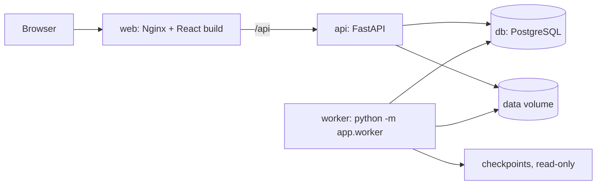

# A2 Sleep Staging — web app

Upload a Sleep-EDF recording, run the two models trained in Assignment 2 (a temporal
Transformer and AttnSleep, each a five-fold soft-voting ensemble), and inspect the result:
hypnogram, per-epoch waveform and probabilities, model-vs-model comparison, agreement with
an expert hypnogram, and CSV/JSON export.

Research prototype. Not a medical device and not for clinical use.


## Architecture



| Part | Stack |
|---|---|
| Frontend | React 19, TypeScript, Vite, TanStack Query, React Router, Tailwind CSS, Apache ECharts |
| API | FastAPI, Pydantic v2, SQLAlchemy 2, Alembic, PostgreSQL 17 |
| Worker | PyTorch (CPU), MNE, NumPy, SciPy; jobs claimed with `SELECT … FOR UPDATE SKIP LOCKED` |
| Tests | pytest (unit, parity, API against real PostgreSQL), Playwright (end-to-end) |
| Delivery | Docker Compose, GitHub Actions |

The API never imports PyTorch; the worker is the same image started with a different command.
PostgreSQL is the job queue, so job state lives in one place and survives restarts.

## Quick start

Requirements: Docker, and the trained checkpoints (next section).

```bash
cd A2/webapp
docker compose up --build
```

Open <http://localhost:8080>. A one-hour sample recording is preloaded: open it and press
**Run Transformer**. The interactive API reference is at <http://localhost:8080/api/docs>.

## Checkpoints

The ten `.pt` files (about 22 MB) are **not** in Git. Each release directory under
`backend/checkpoints/` commits only a `manifest.json` with the constructor arguments, the
preprocessing parameters and the SHA-256 of every fold. Loading verifies the hashes.

```bash
cd backend
# You trained or received A2/runs/<Model>/sleep_waveform_final/fold_*.pt:
uv run python scripts/checkpoints.py package
# Or the files are hosted somewhere as <url>/<release id>/fold_N.pt:
uv run python scripts/checkpoints.py fetch --base-url <url>
uv run python scripts/checkpoints.py verify
```

Without checkpoints the app still starts; the models are shown as unavailable.
For UI work or CI, `scripts/checkpoints.py synthetic --out <dir>` writes random weights with
the real architectures. Point `CHECKPOINTS_DIR` at that directory; the UI flags such a build.

## Using it

1. **Upload** a PSG EDF with `EEG Fpz-Cz` and `EEG Pz-Oz` at 100 Hz (up to 64 MiB), optionally
   with its hypnogram, and pick the models to run. Other channels in the file are ignored.
2. **Wait** for the jobs; progress updates without reloading. A 23.5-hour Sleep-EDF night takes
   about one minute per model on an M3 Pro.
3. **Inspect**: click the hypnogram or use the ← → keys to move between epochs. The selected
   epoch and model are part of the URL, so a view can be shared.
4. **Export** each model's predictions as CSV, or as JSON with model and preprocessing provenance.

Anyone who can reach the app can upload, see and delete recordings — there is no login.
Uploads are removed after 30 days. Do not upload data that identifies a person.

## What the numbers mean

- Model cards show **published** metrics: the A2 held-out test participants, scored inside
  the benchmark window (30 minutes either side of sleep).
- The metrics panel shows agreement **on the recording you are viewing**, and only when a
  hypnogram was uploaded. Its scope switch selects every scored epoch or the benchmark window.
- Inference covers the whole file in consecutive 30-second epochs from its start, including
  long daytime wake that the models rarely saw in training.
- Reference labels are never read during inference; a test asserts that adding a hypnogram
  leaves the predictions unchanged.

## Parity with the research code

The serving code is a port of `A2/model_lib.py` and `A2/preprocessing.py`, checked on three levels:

| Check | Result | Runs in CI |
|---|---|---|
| Networks vs `A2/model_lib.py`, same weights and input | logits equal within 1e-6 | yes |
| Preprocessing vs `A2/preprocessing.prepare_waveforms` on the sample | arrays identical | yes |
| AttnSleep vs published run, night SC4031 (952 epochs) | max probability difference 4.8e-4; 952/952 labels equal | no |
| Transformer vs published run, night SC4031 (952 epochs) | 951/952 labels equal; the one flip has a top-two margin of 2e-4 | no |

The published run used CUDA and this app runs on CPU, so bitwise equality is not expected.
The last two rows need the trained checkpoints and the original night:

```bash
SLEEP_EDF_DIR=/path/to/sleep-cassette uv run pytest -m published
```

## Development

Requirements: [uv](https://docs.astral.sh/uv/), Node 24, Docker (for PostgreSQL).

```bash
cd A2/webapp
docker compose up -d db

cd backend
uv sync
uv run alembic upgrade head
uv run fastapi dev app/main.py          # API on :8000, docs at /api/docs
uv run python -m app.worker             # in a second terminal

cd ../frontend
npm ci
npm run dev                             # UI on :5173, proxies /api to :8000
```

Run one recording without the web app:

```bash
uv run python -m app.ml.cli infer night-PSG.edf --model transformer-a2-v1 --out predictions.csv
```

After changing a route or schema, refresh the contract and the generated types:

```bash
(cd backend && uv run python scripts/export_openapi.py)
(cd frontend && npm run generate:api)
```

### Tests

```bash
cd backend
uv run ruff check .
uv run pytest                           # needs PostgreSQL; creates the sleep_test database

cd ../frontend
npm run lint
npm run build                           # type-check and bundle
npx playwright install chromium         # once
npm run test:e2e                        # against http://localhost:8080 (Docker Compose)
E2E_BASE_URL=http://localhost:5173 npm run test:e2e   # against the dev servers
```

The backend suite generates synthetic checkpoints, so it does not need the trained weights.
Playwright keeps a trace, a screenshot and a video for every failing test
(`npx playwright show-report`).

## API

| Endpoint | Purpose |
|---|---|
| `GET /api/v1/models` | Model releases and their published metrics |
| `GET /api/v1/recordings` | All recordings with their jobs |
| `POST /api/v1/recordings` | Multipart upload: `edf`, optional `hypnogram`, optional `model_ids`. `201` new, `200` already stored |
| `GET /api/v1/recordings/{recording_id}` | One recording |
| `DELETE /api/v1/recordings/{recording_id}` | Delete an upload with its results (`204`) |
| `GET /api/v1/recordings/{recording_id}/epochs/{epoch_index}` | 30 s of filtered EEG at 100 Hz |
| `POST /api/v1/jobs` | Queue `{recording_id, model_id}` (`202`) |
| `GET /api/v1/jobs/{job_id}` | Status, stage, progress, error |
| `GET /api/v1/jobs/{job_id}/predictions` | Stage and five probabilities for every epoch |
| `GET /api/v1/jobs/{job_id}/metrics?scope=all\|benchmark` | Agreement with the hypnogram |
| `GET /api/v1/jobs/{job_id}/export?format=csv\|json` | Download |
| `GET /api/health` | Database reachable, number of runnable models |

Errors use `{"detail": {"code": "EDF_MISSING_CHANNEL", "message": "…"}}`; the frontend and
the tests rely on `code`. A job is `queued → running → succeeded | failed`. Predictions and the
`succeeded` status are committed in one transaction, and a job found `running` when the worker
starts is marked `failed` with `INTERRUPTED` and can be run again.

## Layout

```text
webapp/
├── compose.yaml
├── backend/
│   ├── app/
│   │   ├── main.py            FastAPI app
│   │   ├── worker.py          job loop
│   │   ├── models.py          SQLAlchemy tables
│   │   ├── schemas.py         Pydantic models
│   │   ├── core/              settings, database session
│   │   ├── api/               deps.py, routes/{recordings,jobs,models,health}.py
│   │   ├── services/          EDF validation, storage, metrics, exports
│   │   └── ml/                preprocessing, inference, registry, CLI, networks/
│   ├── alembic/               migrations
│   ├── checkpoints/           manifests (committed) and fold_*.pt (ignored)
│   ├── samples/               one-hour excerpt used as demo and test fixture
│   ├── scripts/               checkpoints.py, export_openapi.py, make_sample.py
│   └── tests/                 unit/, parity/, api/
├── frontend/
│   ├── src/                   api/, pages/, components/, charts/, lib/
│   └── tests/                 e2e/*.spec.ts, pages/ (page objects)
└── data/                      created at runtime, git-ignored
```

Limits and retention are environment variables; see `.env.example` and
`backend/app/core/config.py`.

## Data and licences

- The sample in `backend/samples/` is a one-hour, two-channel excerpt of night SC4031 from
  [Sleep-EDF Database Expanded](https://physionet.org/content/sleep-edfx/1.0.0/) (Kemp et al.,
  PhysioNet), distributed under the Open Data Commons Attribution License v1.0. Its participant
  is in the A2 held-out test split, so neither model was trained on it.
- `backend/app/ml/networks/attnsleep_author.py` is the AttnSleep authors' implementation
  (Eldele et al., 2021), MIT licence, unchanged.
